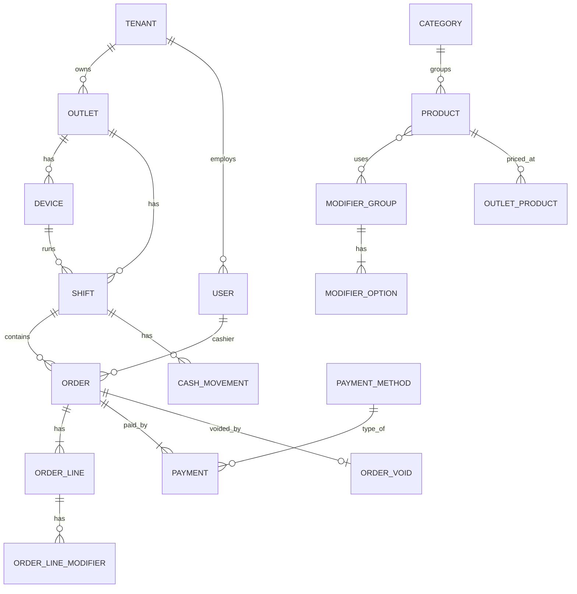

# 06 — Domain Model & Database

## Ubiquitous Language

| Istilah | Arti |
|---|---|
| **Tenant** | Satu bisnis pelanggan SaaS (mis. satu brand restoran). Semua data lain milik tepat satu tenant |
| **Outlet** | Satu cabang/toko fisik milik tenant |
| **Device** | Satu instalasi POS (tablet/PC) yang sudah diaktivasi untuk outlet |
| **Shift** | Sesi kasir di satu device: dibuka dengan modal awal, ditutup dengan hitung kas |
| **Order** | Transaksi penjualan (1 struk). Status MVP: `paid` → (`voided`). Status `open` (open bill / simpan order) baru ada di Fase 4 dine-in |
| **Order Line** | Satu baris item: produk + qty + modifier + catatan (snapshot harga) |
| **Modifier** | Add-on/opsi (prototype: "add_ons"). Dikelompokkan dalam **Modifier Group** (mis. "Topping", "Level Gula") |
| **Payment** | Pembayaran untuk order; satu order bisa beberapa payment (split) |
| **Cash Movement** | Kas masuk/keluar di luar penjualan (mis. beli es batu, setor ke owner) |
| **Business Date** | Tanggal operasional outlet (bukan tanggal kalender) |
| **Basis poin (bps)** | Satuan tarif integer: `100` bps = 1%, `1000` = 10% |
| **Flag** | Tanda audit pada order yang tetap diterima server: `TOTAL_MISMATCH`, `RATES_OUTDATED` |

## Business Rules (invariants)

**Order**
1. Order `paid` hanya jika `sum(payments.amount) >= total` dan minimal 1 payment.
2. `change_amount = sum(cash payments) - (total - non-cash payments)`, ≥ 0. Non-cash tidak boleh melebihi sisa tagihan (tidak ada kembalian non-cash).
3. Order `paid` **immutable**. Koreksi hanya lewat void (butuh permission `order.void` + alasan).
4. Void hanya diperbolehkan pada business date yang sama & shift yang masih terbuka (konfigurasi); setelah itu → refund (fase lanjut).
5. Diskon persen = integer 0..100; diskon nominal = integer Rupiah. Diskon tidak boleh membuat subtotal < 0. Diskon di atas batas role (mis. > 20% untuk kasir) butuh approval PIN manager.
6. Qty > 0, integer (MVP; qty desimal untuk produk timbang = fase lanjut).
7. Total dihitung dengan tarif **snapshot** yang disimpan di order (`service_rate_bps`, `tax_rate_bps`), memakai `divRoundHalfUp` / `div_round_half_up` (ADR-005, ADR-011).

**Pajak & Service (MVP)**
1. Tarif per outlet: `service_rate_bps` dan `tax_rate_bps` (PB1), masing-masing boleh 0.
2. `service = divRoundHalfUp(net × service_bps, 10000)`; `tax = divRoundHalfUp((net + service) × tax_bps, 10000)` — PB1 dihitung dari net + service.
3. Struk menampilkan baris Service dan PB1 hanya bila tarifnya > 0.

**Tenant**
1. Semua data (kecuali tabel global) milik tepat satu tenant; referensi lintas tenant dilarang.
2. Tenant `suspended` tetap boleh push penjualan; perubahan master data diblok.

**Shift**
1. Satu device hanya boleh punya satu shift `open`.
2. Order wajib berada di shift yang `open`.
3. Tutup shift: `expected_cash = opening_cash + cash_sales - cash_change + cash_in - cash_out`; kasir input `counted_cash`; `variance = counted - expected` dicatat (tidak diblok).

**Modifier**
1. Modifier Group punya `min_select`, `max_select` (mis. "Level Gula" min 1 max 1 → radio; "Topping" min 0 max 3 → checkbox). Menggantikan add-on flat di prototype.

## Aggregate & Entity Diagram



## Schema (ringkas)

Konvensi (PostgreSQL 16): PK `ulid` (`char(26)`), uang `BIGINT` (Rupiah), tarif `INTEGER` basis poin, timestamp `TIMESTAMPTZ` (UTC) + `timezone` di outlet. Tabel master punya `version BIGINT NOT NULL` (index, diisi trigger — ADR-009) + `deleted_at`.

**Multi-tenant (ADR-013)**: setiap tabel di bawah punya `tenant_id char(26) NOT NULL` + policy RLS, **kecuali** tabel global `tenants`, `roles`, `permissions`, `role_permissions`. Kolom `tenant_id` tidak ditulis ulang di daftar kolom di bawah agar ringkas. Unique constraint diawali `tenant_id`.

### Tenancy, Organization & Identity

```
tenants          id, slug (unik global), name, status (active|suspended), plan (nullable — Fase 5),
                 default_timezone, created_at, suspended_at                -- global, tanpa RLS
outlets          id, code (unik per tenant, mis. JKT01), name, address, phone, timezone,
                 business_day_cutoff (time, default 04:00), tax_rate_bps (int, mis. 1000),
                 service_rate_bps (int, mis. 500), receipt_header, receipt_footer, version, timestamps, deleted_at
devices          id, outlet_id, code (A, B, …; unik per outlet), name, platform, app_version,
                 last_seen_at, activated_by, revoked_at, timestamps
users            id, name, email (unik global, nullable untuk kasir), password_hash (argon2, nullable), pin_hash, pin_salt,
                 pin_iterations, is_active, version, timestamps, deleted_at
outlet_user      outlet_id, user_id, role_id                               -- PK (outlet_id, user_id); ubah → touch users.version
roles            id, name (owner|manager|cashier)
permissions      id, name (mis. order.void, discount.override, shift.close, cash.move)
role_permissions role_id, permission_id                                    -- PK (role_id, permission_id)
api_tokens       id, owner_type (device|user|platform_admin), owner_id, token_hash (sha256, unik), abilities (text[]),
                 last_used_at, expires_at (nullable untuk device), revoked_at, created_at
audit_logs       id, actor_type, actor_id, action, entity_type, entity_id, before (jsonb), after (jsonb),
                 device_id (nullable), created_at                           -- INDEX (entity_type, entity_id)
```

### Catalog & Payment

```
categories       id, name, sort_order, color, print_role (receipt|kitchen|bar), version, timestamps, deleted_at
products         id, category_id, sku (unik per tenant), name, description, image_url, base_price, is_active, version, …
outlet_products  outlet_id, product_id, price (nullable → pakai base_price), is_available, version
modifier_groups  id, name, min_select, max_select, version, …
modifier_options id, modifier_group_id, name, price, sort_order, version, …
product_modifier_group  product_id, modifier_group_id, sort_order         -- ubah → touch products.version
payment_methods  id, type (cash|debit|qris|credit_card|voucher|other), name, logo_url,
                 requires_reference (bool), sort_order, is_active, version, …
outlet_payment_method   outlet_id, payment_method_id                      -- ubah → touch payment_methods.version
```

### Sales & Shift (data dari device — immutable)

```
shifts           id (ulid dari device), outlet_id, device_id, opened_by, opened_at, opening_cash,
                 closed_by, closed_at, counted_cash, expected_cash, variance, status (open|closed),
                 business_date, synced_at
cash_movements   id, shift_id, type (in|out), amount, reason, created_by, created_at

orders           id (ulid), outlet_id, device_id, shift_id, receipt_no (unik per outlet),
                 cashier_id, business_date, order_type (take_away|dine_in), table_label (nullable),
                 subtotal, discount_type, discount_value, discount_amount,
                 service_rate_bps, tax_rate_bps (snapshot tarif dari device),
                 service_charge, tax, total, paid_amount, change_amount,
                 status (paid|voided), flags (text[], kosong = bersih), notes,
                 created_at (waktu device), synced_at (waktu server)
                 INDEX (outlet_id, business_date), INDEX (shift_id)
order_lines      id, order_id, product_id, product_name (snapshot), category_name (snapshot),
                 unit_price (snapshot), modifiers_total, quantity, line_total, notes, sort_order
order_line_modifiers  id, order_line_id, modifier_option_id, name (snapshot), price (snapshot)
payments         id, order_id, payment_method_id, method_type (snapshot), method_name (snapshot),
                 amount, reference (no. approval EDC / ref QRIS), created_at
order_voids      id, order_id (unik), reason, voided_by, approved_by, voided_at
```

### Sync

```
sync_events      id (ulid event dari device, PK), device_id, type, aggregate_id,
                 status (accepted|flagged|rejected), error_code, payload (jsonb), attempts,
                 received_at, processed_at
                 INDEX (device_id, received_at)           -- rejected boleh diproses ulang
sync_version_seq SEQUENCE + trigger assign_sync_version() di tiap tabel master (ADR-009)
outbox_messages  id (ulid), topic (mis. sales.order_placed), payload (jsonb), created_at,
                 published_at (nullable), attempts, last_error
                 INDEX (published_at) WHERE published_at IS NULL
```

### Reporting (read model) — lihat [05](./05-backend-architecture.md#reporting-read-model)

## Mapping dari Prototype

| Prototype | Target |
|---|---|
| `Product.add_ons[]` | `modifier_groups` + `modifier_options` (dengan min/max) |
| `CartItem.selected_add_ons` | `order_line_modifiers` (snapshot) |
| `Transaction.id: number` | `orders.id` ULID + `receipt_no` |
| `payment_method: "debit-bca"` (string) | `payments.payment_method_id` + snapshot `method_type`, `method_name` |
| `discount {type, value}` | `orders.discount_type`, `discount_value`, `discount_amount` |
| `created_at: "2026-03-09"` | `created_at` (timestamp) + `business_date` |
