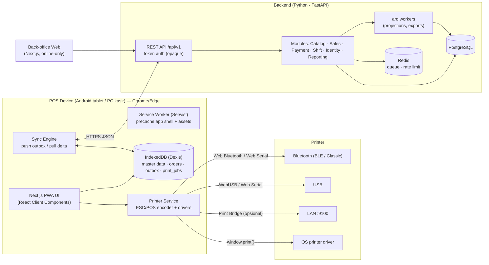

# 01 — System Architecture

## Konteks

POS restoran harus **tetap bisa jualan saat internet mati**. Karena itu arsitekturnya dibalik dari web app biasa: **device adalah sumber kebenaran untuk transaksi yang dibuatnya**, server adalah tempat agregasi, master data, dan laporan lintas device/outlet.

## Diagram Komponen

## Tech Stack

| Layer | Pilihan | Alasan |
|---|---|---|
| POS Frontend | Next.js (App Router, versi stabil terbaru) + TypeScript strict | Sesuai prototype & skill tim |
| UI | Tailwind v4 + shadcn/ui + lucide-react | Sudah dipakai di prototype |
| Service Worker | Serwist (`@serwist/next`, configurator mode) | Penerus next-pwa, precache route hasil prerender |
| Local DB | Dexie.js (IndexedDB) + `dexie-react-hooks` | Query + index + transaction, `useLiveQuery` reaktif |
| UI state | Zustand | Cart aktif, UI session — ringan |
| Validation | Zod | Validasi payload sebelum masuk outbox |
| ID | ULID (`ulidx`) | Sortable by time, dibuat offline |
| Printing | `@point-of-sale/receipt-printer-encoder` + driver WebBluetooth/WebSerial/WebUSB | ESC/POS & StarPRNT dari browser |
| Backend | Python 3.12+ · FastAPI · Pydantic v2 · SQLAlchemy 2.0 async · Alembic | Lihat ADR-008 |
| Auth | Opaque token (hash SHA-256 di DB) per device & per admin | Bisa di-revoke instan |
| DB | PostgreSQL 16 | Sequence untuk `version`, `ON CONFLICT`, advisory lock |
| Queue/Cache | Redis + arq | Projection laporan, rate limit |
| API Docs | OpenAPI bawaan FastAPI → `openapi-typescript` | Tipe TS frontend digenerate dari kontrak backend |
| Back-office | Next.js (online-only, boleh SSR) | Kelola menu, harga, user, laporan |

## Architecture Decision Records (ADR)

### ADR-001 — Offline-first dengan local write

- **Keputusan**: Semua aksi kasir (buat order, bayar, void, buka/tutup shift) ditulis ke IndexedDB + outbox dalam satu Dexie transaction. UI tidak pernah menunggu server.
- **Alternatif ditolak**: "Online dulu, fallback offline" → dua jalur kode, bug muncul tepat saat internet putus.
- **Konsekuensi**: Butuh sync engine, idempotency di server, dan UI status sync.

### ADR-002 — Next.js tetap dipakai, tapi sebagai SPA ter-prerender

- **Keputusan**: Semua route POS adalah Client Component tanpa data server-side (`'use client'` di level feature), di-prerender statis saat build. Tidak ada Server Actions / RSC data fetching di aplikasi POS. Tidak pakai dynamic segment (`/orders/[id]`) → pakai state/query param agar semua halaman bisa di-precache.
- **Kenapa**: Service worker hanya bisa menyajikan halaman yang sudah di-precache. SSR/RSC fetch butuh server = gagal saat offline.
- **Catatan Serwist**: `output: "export"` belum didukung resmi oleh `@serwist/next` (lihat issue serwist#230). Gunakan **configurator mode** (`serwist build` dijalankan setelah `next build`) dan deploy sebagai Node/standalone. Verifikasi di spike Fase 0 → **terverifikasi 2026-09-25** (app shell terbuka offline setelah reload; lihat [hasil spike](./08-roadmap-and-testing.md#hasil-spike-fase-0)). Fallback Vite tidak diperlukan.
- **Alternatif**: Vite + React + `vite-plugin-pwa` — lebih sederhana untuk SPA offline murni. Jadi fallback bila spike Serwist bermasalah; kode `features/*` tetap portable karena tidak bergantung API khusus Next.

### ADR-003 — Client-generated ULID + immutable transactions

- **Keputusan**: ID order/payment/shift dibuat di device (ULID). Order yang sudah `paid` tidak bisa diedit; koreksi = void/refund (dokumen baru yang mereferensikan order asal).
- **Konsekuensi**: Push sync cukup `INSERT … ON CONFLICT DO NOTHING` (idempotent). Tidak perlu conflict resolution untuk transaksi.

### ADR-004 — Master data server-wins, delta pull via change version

- **Keputusan**: Produk, kategori, modifier, harga, payment method, user, setting outlet hanya diubah di back-office. Device menarik perubahan dengan cursor `version` (bigint monotonic), termasuk tombstone untuk data terhapus.
- **Konsekuensi**: Harga di order adalah **snapshot** saat transaksi, bukan referensi ke harga terkini.

### ADR-005 — Integer Rupiah

- **Keputusan**: Semua nominal disimpan dan dihitung sebagai integer (satuan Rupiah). Tarif (pajak, service) disimpan sebagai **basis poin** integer (`1000` = 10%), diskon persen sebagai integer 0..100.
- **Pembulatan**: satu helper integer-only `divRoundHalfUp(n, d)` / `div_round_half_up(n, d)` = `floor((2n + d) / 2d)` untuk n ≥ 0. Tidak ada float (JS) maupun `Decimal`/`round()` (Python) di perhitungan uang → hasil frontend & backend identik secara matematis, dijaga oleh `pricing-cases.json`.
- **Kenapa**: `Math.round(x * 0.1)` bergantung pada presisi float, dan `round()` Python memakai banker's rounding (`round(2.5) == 2`). Aritmetika integer menghilangkan dua sumber selisih itu sekaligus.

### ADR-006 — Modular Monolith (backend)

- **Keputusan**: Satu aplikasi FastAPI, dipecah per bounded context dengan batas yang tegas (tiap module punya domain/application/infrastructure/presentation). Komunikasi antar module lewat domain event atau use-case interface, bukan query langsung ke tabel module lain. Batas di-enforce dengan `import-linter`.
- **Kenapa bukan microservices**: tim kecil, satu database cukup, dan batas module tetap memungkinkan split di masa depan.

### ADR-007 — Printer lewat abstraction

- **Keputusan**: UI hanya memanggil `printService.print(job)`. Pemilihan driver (Bluetooth/Serial/USB/Bridge/System) berdasarkan konfigurasi printer per device yang disimpan di IndexedDB.

### ADR-008 — Backend Python (FastAPI), bukan Laravel

- **Keputusan**: Backend memakai Python + FastAPI + SQLAlchemy 2.0 async + PostgreSQL. Detail & trade-off di [05](./05-backend-architecture.md#adr-008--python-fastapi-menggantikan-laravel).

### ADR-009 — `version` master data diberikan secara serial

- **Masalah**: nilai sequence dibagikan saat INSERT/UPDATE, tapi transaksi bisa commit tidak berurutan. Tx A dapat `version=100` (belum commit), Tx B dapat `101` dan commit, device pull → cursor = 101 → saat A commit, baris `100` **tidak pernah** ditarik device itu.
- **Keputusan**: `version` diisi oleh **trigger PostgreSQL** yang lebih dulu mengambil `pg_advisory_xact_lock(<SYNC_VERSION_LOCK>, hashtext(tenant_id))` lalu `nextval('sync_version_seq')`. Lock dipegang sampai commit, sehingga di dalam satu tenant version N+1 tidak mungkin dibagikan sebelum transaksi pemegang N selesai → urutan version = urutan commit **per tenant**. Sequence tetap global; itu aman karena device hanya pernah melihat baris tenant-nya sendiri, dan `next_cursor` selalu version terakhir yang benar-benar dikirim.
- **Konsekuensi**: penulisan master data terserialisasi **per tenant** (tenant lain tidak saling menunggu). Dapat diterima karena volumenya rendah; transaksi back-office harus pendek (import besar dipecah per batch). Detail di [05](./05-backend-architecture.md#flow-delta-pull).
- **Alternatif ditolak**: membatasi pull dengan `pg_snapshot_xmin` — benar tapi rumit dan sulit dites; jeda waktu pada cursor — tidak menjamin.

### ADR-010 — Transaksi dimiliki oleh pemanggil, bukan use case

- **Keputusan**: Use case (`PlaceOrderHandler`, dst.) menerima `UnitOfWork` sebagai argumen dan **tidak pernah commit**. Yang membuka & commit transaksi adalah entrypoint: `PushEventsHandler` (satu transaksi per batch, SAVEPOINT per event) atau dependency router back-office (satu transaksi per request).
- **Kenapa**: use case yang sama dipakai dari push sync (butuh savepoint per event) dan dari HTTP biasa; kalau use case commit sendiri, savepoint & atomisitas batch rusak. Detail di [05](./05-backend-architecture.md#transaksi--unit-of-work).

### ADR-011 — Snapshot tarif di setiap order

- **Keputusan**: Payload `order.placed` membawa `rates` (`service_bps`, `tax_bps`) yang dipakai device saat transaksi, dan disimpan di tabel `orders`. Server menghitung ulang total **dengan tarif snapshot**, bukan tarif outlet saat ini.
- **Kenapa**: jika tarif outlet diubah saat device offline, order yang sah akan terlihat selisih dan ter-flag palsu. Perbedaan tarif snapshot vs tarif outlet tetap dicatat sebagai flag informasional `RATES_OUTDATED`.

### ADR-012 — Transactional outbox di server

- **Keputusan**: Domain event (`OrderPlaced`, `OrderVoided`, `ShiftClosed`) ditulis ke tabel `outbox_messages` **dalam transaksi yang sama** dengan perubahan data. Worker arq me-relay pesan yang belum terkirim (`FOR UPDATE SKIP LOCKED`) ke projector.
- **Kenapa**: enqueue langsung ke Redis setelah commit bisa gagal (Redis mati, proses crash) → laporan diam-diam tidak lengkap. Dengan outbox, delivery at-least-once; projector sudah idempotent.

### ADR-013 — Multi-tenant SaaS: shared database + Row-Level Security

- **Keputusan**: Satu database & satu schema untuk semua tenant. Setiap tabel milik tenant punya `tenant_id NOT NULL` dan **policy RLS** `tenant_id = current_setting('app.tenant_id')`. API terhubung dengan role DB tanpa `BYPASSRLS` dan bukan owner tabel (`FORCE ROW LEVEL SECURITY`). Tenant ditentukan dari token (device / user), lalu di-set per transaksi dengan `set_config('app.tenant_id', …, true)`.
- **Kenapa**: murah dioperasikan (satu migrasi, satu connection pool), cocok untuk banyak tenant kecil (restoran UMKM). RLS menjadi jaring pengaman: bug lupa `WHERE tenant_id` tidak membocorkan data tenant lain.
- **Alternatif ditolak**: schema per tenant (migrasi × N, trigger/sequence per schema) dan database per tenant (biaya ops tinggi). Bisa ditawarkan nanti untuk klien enterprise tanpa mengubah kode domain.
- **Konsekuensi**: unique constraint & index diawali `tenant_id`; test isolasi antar tenant wajib untuk setiap tabel/endpoint baru; job lintas tenant (relay outbox) memakai role terpisah dan men-set tenant per pesan. Detail di [05](./05-backend-architecture.md#multi-tenancy-adr-013).

### ADR-014 — Back-office sebagai app terpisah (`poslite-admin`)

- **Keputusan**: Back-office (pemilik/manajer) dan konsol operator SaaS (`/platform`) adalah app Next.js tersendiri di `poslite-admin` (port dev 3001, deploy ke `admin.<domain>`), bukan route di dalam PWA POS.
- **Kenapa**: back-office online-only dan boleh SSR, sedangkan POS wajib SPA ter-prerender dengan service worker (ADR-002). Memisahkan app membuat halaman admin tidak ikut di-precache, bundle POS tetap kecil, dan aturan offline tidak berlaku untuk admin.
- **Konsekuensi**: komponen shadcn/ui dan konfigurasi tooling diduplikasi (belum ada paket bersama). Tipe API admin di-generate dari `poslite-api/openapi.json` (`make admin-types`, dicek CI) dan dipakai lewat `openapi-fetch`. Token back-office disimpan di `localStorage` (12 jam, opaque, bisa dicabut) — cookie httpOnly menyusul bila dibutuhkan.
### ADR-015 — Open bill hanya di device yang membukanya

- **Keputusan**: Bill dine-in yang belum dibayar (open bill) disimpan di IndexedDB tablet yang membukanya (`openBills`), **tidak** disinkronkan dan tidak masuk outbox. Server baru menerima penjualan saat bill dibayar, sebagai `order.placed` biasa (`order_type: dine_in`, `table_label`). Split bill = beberapa `order.placed` dari satu bill.
- **Kenapa**: order di server tetap immutable (ADR-003) dan tidak ada state mutable yang harus diselesaikan konfliknya antar device; open bill tetap jalan 100% offline.
- **Konsekuensi**: tablet lain tidak melihat bill terbuka; tablet rusak/hilang = bill terbuka hilang (belum ada uang yang diterima). Shift tidak bisa ditutup selama masih ada bill terbuka. Berbagi bill antar tablet (pelayan ↔ kasir) = keputusan terpisah di masa depan.

### ADR-016 — Diskon per item & promo otomatis dihitung di device

- **Keputusan**: Setiap baris boleh punya **satu** diskon (`percentage` 0..100 atau `fixed` Rupiah, dibatasi nilai baris) — dari kasir (manual) atau dari promo otomatis. Promo (`percent_off`, `buy_x_get_y`) adalah master data dari back-office yang di-pull ke device dan dievaluasi **offline** pada saat bayar, memakai jam & zona waktu outlet. Server tidak mengevaluasi ulang kelayakan promo; ia menyimpan snapshot promo per baris dan menghitung ulang aritmetika total (flag `TOTAL_MISMATCH` bila beda).
- **Kenapa**: kasir harus bisa memberi harga promo tanpa internet; jam device bisa sedikit beda dari server, sehingga menolak order karena "promo sudah lewat" akan merugikan pelanggan yang sudah bayar.
- **Konsekuensi**: aturan harga ada di dua bahasa → `pricing-cases.json` wajib memuat kasus diskon baris; aturan pemilihan promo diuji di web. Diskon manual menggantikan promo pada baris itu; bila beberapa promo berlaku, diambil diskon terbesar.

### ADR-017 — Payment gateway di balik port, vendor dipilih nanti

- **Keputusan**: QRIS dinamis dan tagihan langganan memakai port `PaymentGateway` (`create_qris`, `create_invoice_payment`, `verify_webhook`). Implementasi awal adalah `FakeGateway` (dev, test, e2e) dengan webhook yang ditandatangani HMAC. Adapter vendor (Midtrans/Xendit) ditambah tanpa mengubah modul lain.
- **Kenapa**: vendor belum diputuskan; alur bisnis (charge → webhook → lunas) bisa dibangun dan diuji penuh lebih dulu.
- **Konsekuensi**: `PAYMENT_GATEWAY=fake` adalah default; produksi wajib memilih adapter asli. Webhook masuk selalu diverifikasi tanda tangannya dan idempoten (charge yang sudah `paid` tidak diproses ulang).

### ADR-018 — Langganan per outlet per bulan, trial, suspend otomatis

- **Keputusan**: Tenant baru mendapat trial 14 hari. Setelah trial/periode habis, job harian membuat tagihan bulanan = jumlah outlet aktif × harga per outlet (snapshot di tagihan). Tagihan jatuh tempo 7 hari (grace); lewat grace tanpa bayar → tenant `suspended` (aturan suspend Fase 3: jualan & sync jalan, tulis back-office diblok). Pembayaran (webhook gateway) → tagihan `paid`, periode maju satu bulan, tenant aktif lagi.
- **Kenapa**: harga naik seiring skala pelanggan; suspend tidak pernah menghentikan kasir berjualan.
- **Konsekuensi**: suspend karena billing dan suspend manual operator dibedakan (`suspended_reason`); pembayaran hanya mengaktifkan kembali suspend karena billing.

### ADR-019 — QRIS dinamis saat online, QRIS statis saat offline

- **Keputusan**: Saat online, kasir bisa menampilkan QR dinamis sejumlah tagihan (charge di server lewat gateway); lunas dikonfirmasi otomatis (webhook → device polling), nomor referensi terisi sendiri. Saat offline atau gateway bermasalah, alur lama tetap: QRIS statis + kasir mengetik nomor referensi.
- **Kenapa**: jualan tidak boleh terblok oleh internet (ADR-001), tapi konfirmasi otomatis mengurangi salah input & fraud saat online.
- **Konsekuensi**: `order.placed` tetap satu-satunya sumber penjualan; payment QRIS dinamis membawa `reference` = id charge. Server memberi flag `QRIS_UNPAID` bila referensi adalah charge dinamis yang belum lunas.

### ADR-020 — Integrasi lewat webhook keluar dari outbox

- **Keputusan**: Tenant mendaftarkan endpoint webhook (URL + tipe event). Subscriber outbox membuat baris `webhook_deliveries` (idempoten per endpoint × event); job worker mengirim `POST` JSON bertanda tangan `X-Poslite-Signature: t=<unix>,v1=<hmac-sha256>` dengan retry backoff sampai 8 kali lalu `dead`, bisa dikirim ulang dari back-office. Event awal: `order.placed` (detail order lengkap), `shift.closed`.
- **Kenapa**: inventory/ERP/RestaurantOps tetap di sistem lain (Fase 5 roadmap); webhook bertanda tangan adalah kontrak paling sederhana dan tidak butuh sistem lain memanggil kita.
- **Konsekuensi**: pengiriman at-least-once → penerima wajib idempoten memakai `id` event. Secret endpoint hanya ditampilkan sekali saat dibuat.

## Non-Functional Requirements

| NFR | Target |
|---|---|
| Offline duration | Minimal 3 hari tanpa internet tanpa kehilangan data |
| Checkout latency | < 300 ms dari tap "Bayar" sampai struk dikirim ke printer (lokal) |
| Sync | Outbox terkirim < 30 detik setelah online |
| Data loss | 0 transaksi hilang (IndexedDB `persist()` + outbox retry + export manual darurat) |
| Katalog | Lancar untuk ≥ 2.000 SKU per outlet |
| Keamanan | PIN tidak pernah disimpan plain; token device bisa di-revoke dari back-office |
| Isolasi tenant | Tidak ada query aplikasi yang bisa membaca/menulis data tenant lain (RLS + test isolasi) |

## Deployment (awal)

- **API**: VPS / container (Caddy/Nginx + gunicorn/uvicorn + arq worker + Redis + PostgreSQL), domain `api.<domain>`.
- **POS PWA**: Vercel / Node server, domain `pos.<domain>` (HTTPS wajib — Web Bluetooth/USB/Serial & service worker hanya jalan di secure context).
- **Back-office**: `admin.<domain>` — satu app untuk semua tenant; tenant ditentukan dari akun yang login. Halaman signup tenant publik di domain yang sama.
- Android tablet: install PWA via "Add to Home screen"; opsional kiosk mode (Chrome kiosk / MDM).
