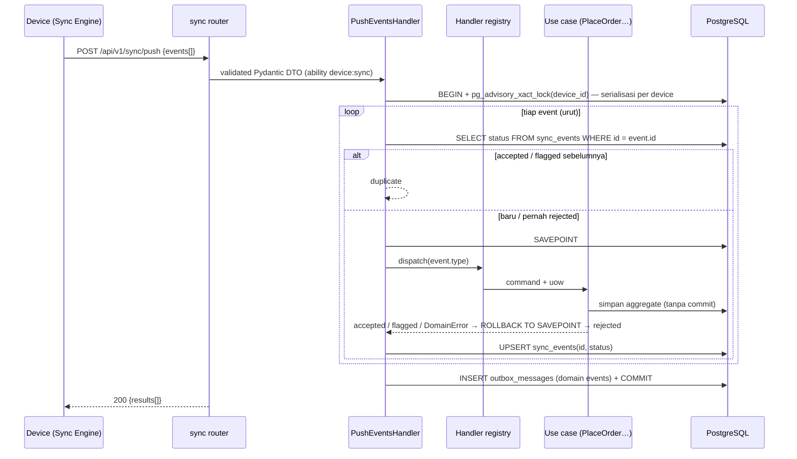

# 05 — Backend Architecture (Python / FastAPI)

## Gaya Arsitektur

**Modular Monolith** — tiap bounded context adalah package dengan layer **Clean/Hexagonal** di dalamnya (domain → application → infrastructure → presentation). **CQRS ringan**: command mengubah write model (order, payment, shift); laporan dibaca dari **read model** (tabel ringkasan) yang di-update oleh worker.

Kenapa tidak full Event Sourcing: event dari device sudah immutable dan disimpan (`sync_events`) sebagai audit trail — itu cukup. State tetap disimpan di tabel relasional biasa.

## Tech Stack

| Kebutuhan | Pilihan | Catatan |
|---|---|---|
| Runtime | Python 3.12+ | |
| Web framework | **FastAPI** | Async, OpenAPI otomatis → tipe TS frontend |
| Validation / DTO | Pydantic v2 | Hanya di application & presentation, **bukan** di domain |
| ORM | SQLAlchemy 2.0 async (`asyncpg`) | Imperative/declarative model di infrastructure saja |
| Migration | Alembic | Review autogenerate sebelum commit |
| Database | **PostgreSQL 16+** (dev: instalasi lokal, mis. Homebrew) | `ON CONFLICT DO NOTHING`, sequence untuk `version`, advisory lock |
| Background jobs | `arq` (async, Redis) | Projection laporan, export |
| Cache / rate limit | Redis | |
| Password hash | `argon2-cffi` | Password admin/manager |
| PIN hash | PBKDF2-SHA256 (`hashlib.pbkdf2_hmac`) | Kompatibel dengan WebCrypto di device |
| ULID | `python-ulid` | Validasi & generate ID sisi server |
| Settings | `pydantic-settings` | |
| Package manager | `uv` | |
| Lint / format | `ruff` | |
| Type check | `mypy --strict` | |
| Testing | `pytest`, `pytest-asyncio`, `httpx.AsyncClient`, `pytest-cov` | Integration test memakai database lokal `poslite_test` |
| Observability | `structlog`, Sentry, OpenTelemetry (opsional) | |
| Server | `uvicorn` (workers via `gunicorn -k uvicorn.workers.UvicornWorker`) | |

## ADR-008 — Python (FastAPI) menggantikan Laravel

- **Keputusan**: Backend memakai Python + FastAPI + SQLAlchemy 2.0 async + PostgreSQL.
- **Alasan**: preferensi tim; FastAPI menghasilkan OpenAPI otomatis (kontrak ke frontend tanpa tool tambahan); async cocok untuk endpoint sync yang I/O-bound.
- **Alternatif**: Django + DRF — kelebihannya Django Admin bisa jadi back-office master data "gratis". Ditolak karena ORM Django sulit dipisah dari domain (bertentangan dengan Clean Architecture) dan back-office tetap direncanakan di Next.js.
- **Konsekuensi**: hal yang di Laravel "sudah jadi" harus dibangun sendiri: token auth (pengganti Sanctum), RBAC (pengganti spatie/permission), audit log, queue dashboard. Semuanya kecil dan dijelaskan di bawah.

## Bounded Contexts

| Module | Tanggung jawab | Write / Read |
|---|---|---|
| **tenancy** | Tenant (bisnis pelanggan SaaS), signup/onboarding, status aktif/suspend; plan & billing (Fase 5) | Write |
| **identity** | User, role & permission, PIN, API token (device & back-office) | Write |
| **organization** | Outlet, device, setting outlet (pajak, service, header struk) | Write |
| **catalog** | Category, product, modifier group/option, harga per outlet | Write (master) |
| **payment** | Master payment method (type: cash/debit/qris/credit_card/voucher) | Write (master) |
| **sales** | Order, order line, discount, void, receipt number | Write (dari device) |
| **shift** | Buka/tutup shift, cash movement, rekonsiliasi kas | Write (dari device) |
| **sync** | Push batch event, delta pull, idempotency, device cursor | Orkestrasi |
| **reporting** | Read model: daily sales, per product, per category, per payment, per cashier | Read |

Aturan antar module:
- `sync` memanggil **use case** module lain lewat interface (`EventHandler` registry) — tidak menyentuh model SQLAlchemy module lain.
- `reporting` hanya bereaksi terhadap **domain event** (`OrderPlaced`, `OrderVoided`, `ShiftClosed`) yang dikirim lewat outbox setelah commit.
- `sales` butuh tarif outlet saat ini (flag `RATES_OUTDATED`) → lewat port `OutletRatesPort` yang diimplementasikan `organization`, bukan query tabel `outlets`.
- Module tidak meng-import `infrastructure` module lain. Enforce dengan **`import-linter`** (contract `layers` + `independence`).

## Struktur Folder

```
poslite-api/
├── pyproject.toml                       # uv, ruff, mypy, pytest, import-linter config
├── alembic.ini
├── migrations/                          # Alembic (satu history untuk seluruh app)
├── src/poslite/
│   ├── main.py                          # create_app(): FastAPI, router, middleware, exception handlers
│   ├── worker.py                        # arq WorkerSettings
│   ├── shared/
│   │   ├── domain/                      # money.py (Money, div_round_half_up), Ulid, DomainEvent, DomainError
│   │   ├── application/                 # UnitOfWork Protocol, Clock Protocol
│   │   ├── infrastructure/
│   │   │   ├── database.py              # engine, async_sessionmaker
│   │   │   ├── unit_of_work.py          # SqlAlchemyUnitOfWork (savepoint, outbox write, commit)
│   │   │   ├── outbox.py                # OutboxMessageModel + relay job (arq)
│   │   │   ├── sync_version.py          # mixin: kolom version (server-generated oleh trigger)
│   │   │   ├── tenancy.py               # TenantContext, set_config('app.tenant_id') per transaksi, helper migrasi RLS
│   │   │   └── redis.py
│   │   └── presentation/
│   │       ├── envelope.py              # ApiResponse[T], ErrorResponse
│   │       ├── errors.py                # DomainError → HTTP mapping
│   │       └── security.py              # token auth dependency, require_ability(), require_permission()
│   │
│   ├── sales/
│   │   ├── domain/
│   │   │   ├── entities.py              # Order (aggregate root), OrderLine, Payment
│   │   │   ├── value_objects.py         # OrderId, ReceiptNumber, Discount, LineModifier
│   │   │   ├── services.py              # PriceCalculator (pure)
│   │   │   ├── events.py                # OrderPlaced, OrderVoided
│   │   │   ├── exceptions.py
│   │   │   └── repository.py            # OrderRepository(Protocol)
│   │   ├── application/
│   │   │   ├── commands.py              # PlaceOrder, VoidOrder (frozen dataclass / Pydantic)
│   │   │   ├── place_order.py           # PlaceOrderHandler
│   │   │   ├── void_order.py
│   │   │   └── queries.py               # GetOrderDetail, ListOrders (read side)
│   │   ├── infrastructure/
│   │   │   ├── models.py                # SQLAlchemy OrderModel, OrderLineModel, PaymentModel
│   │   │   ├── repository.py            # SqlAlchemyOrderRepository
│   │   │   └── mappers.py
│   │   └── presentation/
│   │       ├── router.py                # back-office: GET /orders, /orders/{id}
│   │       └── schemas.py
│   ├── shift/        (struktur sama)
│   ├── catalog/      (lebih tipis — lihat catatan)
│   ├── payment/
│   ├── organization/
│   ├── tenancy/      (tipis: models + service + router)
│   ├── identity/
│   ├── sync/
│   │   ├── application/
│   │   │   ├── push_events.py           # PushEventsHandler
│   │   │   ├── pull_changes.py          # PullChangesHandler
│   │   │   └── registry.py              # event type → handler (sales/shift use cases)
│   │   ├── infrastructure/models.py     # SyncEventModel
│   │   └── presentation/router.py       # POST /sync/push, GET /sync/pull
│   └── reporting/
│       ├── projections.py               # DailySalesProjector (arq task, idempotent)
│       ├── models.py                    # read model tables
│       └── presentation/router.py
└── tests/
    ├── conftest.py                      # app factory, async client, db (TEST_DATABASE_URL → poslite_test), fixtures
    ├── fixtures/pricing-cases.json      # dibagi dengan poslite-web
    ├── unit/<module>/                   # domain & use case — tanpa DB/network
    ├── integration/<module>/            # repository, UoW, projector — Postgres asli
    └── e2e/<module>/                    # HTTP lewat httpx.AsyncClient
```

> Pragmatis: **catalog, payment, organization** CRUD-heavy → cukup `models.py` + `service.py` + `router.py` + `schemas.py`, tanpa entity terpisah (tetap ada test). DDD penuh hanya di **sales** dan **shift**.

## Pola Inti

### Transaksi & Unit of Work

Aturan (ADR-010): **use case tidak pernah commit**. Transaksi dibuka dan di-commit oleh entrypoint:

| Entrypoint | Transaksi |
|---|---|
| `PushEventsHandler` (sync) | 1 transaksi per batch, **SAVEPOINT per event** |
| Router back-office | 1 transaksi per request, lewat dependency `get_uow()` |
| Job arq (projector, relay) | 1 transaksi per job |

```python
# shared/application/unit_of_work.py
class UnitOfWork(Protocol):
    orders: OrderRepository
    shifts: ShiftRepository
    sync_events: SyncEventRepository

    async def __aenter__(self) -> Self: ...
    async def __aexit__(self, *exc: object) -> None: ...   # rollback bila exception / belum commit
    def savepoint(self) -> AbstractAsyncContextManager[None]: ...  # begin_nested(); rollback → event domain di dalamnya ikut dibuang
    async def lock_device(self, device_id: DeviceId) -> None: ...  # pg_advisory_xact_lock
    async def commit(self) -> None: ...  # tulis domain event yang terkumpul ke outbox_messages, lalu COMMIT
```

Aggregate mengumpulkan event di `self.events`. Saat `commit()`, UoW menulis event dari aggregate yang **lolos** (savepoint-nya tidak di-rollback) ke tabel `outbox_messages` di transaksi yang sama, lalu COMMIT. Tidak ada publish langsung ke Redis dari request path (ADR-012).

### Use case (contoh)

```python
# sales/application/place_order.py
class PlaceOrderHandler:
    def __init__(self, calculator: PriceCalculator, outlets: OutletRatesPort) -> None:
        self._calculator = calculator
        self._outlets = outlets

    async def __call__(self, cmd: PlaceOrder, uow: UnitOfWork) -> EventOutcome:
        shift = await uow.shifts.get(cmd.shift_id)
        order = Order.place(cmd, shift=shift)                      # domain validates invariants → DomainError
        expected = self._calculator.calculate(order.priced_lines(), order.discount, cmd.rates)  # snapshot (ADR-011)
        if expected != cmd.totals:
            order.flag("TOTAL_MISMATCH")                           # terima, tandai untuk audit
        if cmd.rates != await self._outlets.current_rates(order.outlet_id):
            order.flag("RATES_OUTDATED")                           # informasional
        await uow.orders.add(order)                                # TIDAK commit — milik pemanggil
        return EventOutcome.from_order(order)                      # accepted | flagged(+flags)
```

### Push handler (entrypoint)

```python
# sync/application/push_events.py
async def __call__(self, device: Device, events: list[IncomingEvent]) -> list[EventResult]:
    results: list[EventResult] = []
    async with self._uow_factory() as uow:
        await uow.lock_device(device.id)                           # serialisasi per device
        for event in events:
            previous = await uow.sync_events.get_status(event.id)
            if previous in ("accepted", "flagged"):
                results.append(EventResult.duplicate(event.id))
                continue
            try:
                async with uow.savepoint():
                    outcome = await self._registry.dispatch(event, device, uow)
            except DomainError as err:
                outcome = EventOutcome.rejected(err.code)
            await uow.sync_events.upsert(event, device.id, outcome)  # di luar savepoint → rejected pun tercatat
            results.append(EventResult.of(event.id, outcome))
        await uow.commit()
    return results
```

- Event yang sebelumnya `rejected` **diproses ulang** bila dikirim lagi (manager membereskan penyebabnya lalu kirim ulang dari device).
- Error non-domain (bug, DB down) tidak ditangkap → seluruh batch rollback → device menerima 5xx dan retry dengan backoff.

### Money & pembulatan (domain, murni Python)

```python
# shared/domain/money.py
@dataclass(frozen=True, slots=True)
class Money:
    amount: int  # Rupiah

    def __post_init__(self) -> None:
        if not isinstance(self.amount, int) or isinstance(self.amount, bool):
            raise TypeError("Money must be integer Rupiah")

    def __add__(self, other: "Money") -> "Money": return Money(self.amount + other.amount)
    def __sub__(self, other: "Money") -> "Money": return Money(self.amount - other.amount)


def div_round_half_up(n: int, d: int) -> int:
    """Half-up integer division for n >= 0. Mirrors divRoundHalfUp in poslite-web."""
    if n < 0 or d <= 0:
        raise ValueError("div_round_half_up expects n >= 0 and d > 0")
    return (2 * n + d) // (2 * d)
```

Tarif = basis poin integer (`Rates(service_bps=500, tax_bps=1000)`), diskon persen = integer 0..100. Perhitungan uang **tidak** memakai `float`, `Decimal`, maupun `round()` (banker's rounding: `round(2.5) == 2`). Kasus `.5` wajib ada di `pricing-cases.json`.

## Flow: Push Sync



Aturan penting:
- **Idempotency by event id** (ULID dari device) — PK `sync_events (tenant_id, id)`: dengan RLS, baris tenant lain tidak terlihat, jadi kunci global membuat tabrakan id antar-tenant menggagalkan seluruh batch (diperbaiki di migrasi 0006). Pelanggaran unik lain dari data device (`id`, `receipt_no`) menjadi `rejected` per event (`ID_CONFLICT` / `RECEIPT_NO_TAKEN`), bukan 500. Row `sync_events` + efek event dalam transaksi yang sama. Event `accepted`/`flagged` tidak pernah diproses dua kali; event `rejected` boleh diproses ulang.
- **SAVEPOINT per event** (`session.begin_nested()`): satu event `rejected` tidak membatalkan event lain di batch. Domain event dari savepoint yang di-rollback ikut dibuang.
- **Serialisasi per device** dengan `pg_advisory_xact_lock(hashtext(device_id))` — tanpa perlu Redis lock. Karena lock dipegang sampai commit, dua push paralel dari device yang sama tidak bisa saling membaca status `sync_events` yang belum commit.
- **Server menghitung ulang total dengan tarif snapshot** di payload (ADR-011); bila selisih → `flagged`, bukan ditolak.
- Semua I/O async. Dilarang memanggil library blocking (`requests`, `time.sleep`) di dalam `async def`.

## Flow: Delta Pull

- Tabel master punya kolom `version BIGINT NOT NULL` (index) + `deleted_at`.
- `version` diisi **hanya oleh trigger DB** (ADR-009) — ORM memperlakukannya sebagai server-generated (`FetchedValue()`, `eager_defaults=True`), tidak pernah menulisnya sendiri:

```sql
CREATE SEQUENCE sync_version_seq;

CREATE FUNCTION assign_sync_version() RETURNS trigger AS $$
BEGIN
  -- Serialize version assignment until commit so version order == commit order.
  -- Lock per tenant: tenants don't block each other; within a tenant, version order == commit order.
  PERFORM pg_advisory_xact_lock(727001, hashtext(NEW.tenant_id));  -- 727001 = SYNC_VERSION_LOCK
  NEW.version := nextval('sync_version_seq');
  RETURN NEW;
END $$ LANGUAGE plpgsql;

-- dipasang di setiap tabel master via migration helper
CREATE TRIGGER trg_products_sync_version BEFORE INSERT OR UPDATE ON products
  FOR EACH ROW EXECUTE FUNCTION assign_sync_version();
```

- Soft delete = UPDATE `deleted_at` → version ikut naik → dikirim sebagai `op: "delete"`.
- **Tabel relasi tanpa cursor sendiri** (`product_modifier_group`, `user_assignments`, `outlet_payment_method`): perubahan di tabel ini wajib men-*touch* baris induknya (product / user / payment_method) dalam transaksi yang sama, supaya induk ikut terkirim ulang dengan data relasi terbaru.
- Transaksi back-office harus pendek (lock per tenant dipegang sampai commit). Import massal dipecah per batch ±500 baris.
- `PullChangesHandler` meng-query tiap entity master `WHERE <outlet scope> AND version > :cursor ORDER BY version LIMIT :n`, merge, sort, potong ke `:n`, return `next_cursor` = version terakhir yang dikirim.

## Multi-tenancy (ADR-013)

**Model**: shared database, `tenant_id` di setiap tabel milik tenant, di-enforce **PostgreSQL Row-Level Security**.

```sql
-- dipasang untuk setiap tabel tenant via helper migrasi enable_tenant_rls('<table>')
ALTER TABLE products ENABLE ROW LEVEL SECURITY;
ALTER TABLE products FORCE ROW LEVEL SECURITY;
CREATE POLICY tenant_isolation ON products
  USING (tenant_id = current_setting('app.tenant_id', true))
  WITH CHECK (tenant_id = current_setting('app.tenant_id', true));
```

| Role DB | Dipakai oleh | Hak |
|---|---|---|
| `poslite` (owner) | Alembic migration (`MIGRATION_DATABASE_URL`) | Owner tabel; RLS tetap berlaku (`FORCE`) |
| `poslite_app` | API & job per-tenant (`DATABASE_URL`) | DML saja, **tanpa** `BYPASSRLS` |
| `poslite_system` | Relay outbox (polling lintas tenant), lookup token, platform admin (`SYSTEM_DATABASE_URL`) | `BYPASSRLS`, hanya untuk tabel yang diperlukan |

Ketiga role dibuat oleh `make db-setup` (lokal) dan step CI; SQL RLS/trigger ada di `shared/infrastructure/migration_sql.py`.

Alur tenant context:
1. Middleware auth me-resolve token → `api_tokens.tenant_id` (device & user) → `TenantContext`.
2. `SqlAlchemyUnitOfWork.__aenter__` menjalankan `SELECT set_config('app.tenant_id', :tid, true)` — **transaction-local**, aman dengan connection pool.
3. Insert mengisi `tenant_id` dari `TenantContext`; SELECT dilindungi RLS. Repository tetap boleh menulis filter `tenant_id` eksplisit (defense in depth), tapi keamanan tidak bergantung padanya.
4. Tanpa `app.tenant_id` → policy tidak cocok → 0 baris (gagal aman).
5. Relay outbox: `poslite_system` mengambil batch pesan, lalu setiap pesan diproses di transaksi `poslite_app` dengan `app.tenant_id` = `outbox_messages.tenant_id`.

Aturan:
- Semua unique constraint & index utama diawali `tenant_id` (mis. `UNIQUE (tenant_id, code)` di `outlets`, `UNIQUE (tenant_id, sku)` di `products`).
- Tabel global (tanpa RLS): `tenants`, `roles`, `permissions`, `role_permissions`. Semua tabel lain wajib `tenant_id` + policy.
- Tenant `suspended`: back-office write → 403 `TENANT_SUSPENDED`; **push sync tetap diterima** (data penjualan pelanggan tidak boleh hilang); pull tetap jalan.
- Rate limit per tenant **dan** per device.
- Platform admin (operator SaaS) memakai ability `platform:*` dan endpoint `/platform/*`, terpisah dari role tenant.

## Auth & Authorization (pengganti Sanctum + spatie/permission)

| Aktor | Mekanisme | Ability |
|---|---|---|
| Platform admin (operator SaaS) | Email + password + 2FA → access token | `platform:*` |
| Owner / Manager (back-office) | Email + password (argon2) → access token (opaque, 12 jam) + refresh token, terikat ke tenant user | `backoffice:*` |
| Device POS | Opaque token jangka panjang dibuat saat aktivasi | `device:sync`, `device:read` |
| Kasir | **Tidak** punya token; `cashier_id` dibawa di payload event dan divalidasi server | — |

- Token = random 32 byte (`secrets.token_urlsafe`), disimpan **hash SHA-256** di tabel `api_tokens` (id, tenant_id, owner_type, owner_id, abilities, last_used_at, expires_at, revoked_at). Lookup token terjadi sebelum tenant diketahui → dilakukan oleh `poslite_system` lewat satu query sempit, lalu tenant context di-set. Opaque dipilih ketimbang JWT karena harus bisa **revoke instan** per device.
- Dependency FastAPI: `current_device = Depends(require_ability("device:sync"))`.
- RBAC sederhana: tabel `roles`, `permissions`, `role_permissions`, `user_assignments` (role × scope perusahaan/brand/outlet, ADR-022). Permission sensitif: `order.void`, `order.refund`, `discount.override`, `shift.close`, `cash.move`, `sync.import`.
- **Akses brand/outlet di back-office** (ADR-022): dependency `identity.Access` menghitung `AccessScope` dari assignment owner/manager; `ReadBrand`/`ManagedBrand` memvalidasi `X-Brand-Id`, `ensure_outlet` memvalidasi outlet, `company_only` untuk halaman perusahaan. Setiap endpoint back-office baru wajib memakainya dan punya test matriks akses (`tests/e2e/organization/test_brand_access.py`).
- Middleware: catat `last_seen_at` & `app_version` device; tolak `X-App-Version` di bawah minimum (426).
- Rate limit: Redis (mis. `fastapi-limiter` atau middleware sendiri) — ketat di `/auth/*`, per device di `/sync/*`.
- Audit: tabel `audit_logs` (actor, action, entity, before/after JSON) untuk perubahan harga, user, device.

## Reporting (Read Model)

Domain event sampai ke projector lewat **transactional outbox** (ADR-012):

1. `UnitOfWork.commit()` menulis event ke `outbox_messages` di transaksi yang sama dengan data.
2. Setelah commit, request path melakukan *best-effort* `enqueue("relay_outbox")`. Gagal enqueue tidak apa-apa.
3. Cron arq (tiap ±5 detik) juga menjalankan `relay_outbox`: ambil pesan `published_at IS NULL` dengan `FOR UPDATE SKIP LOCKED`, jalankan projector, set `published_at`. Gagal → `attempts++`, dicoba lagi.
4. Delivery **at-least-once** → projector wajib idempotent.

Tabel ringkasan di-update projector:
- `rpt_daily_sales` (outlet_id, business_date, gross, discount, service, tax, net, order_count, void_count)
- `rpt_daily_product_sales` (outlet_id, business_date, product_id, qty, gross)
- `rpt_daily_payment_sales` (outlet_id, business_date, payment_method_id, amount, count)
- `rpt_shift_summaries`

Projector **idempotent**: hitung ulang agregat untuk `(outlet_id, business_date)` yang terdampak lalu `INSERT … ON CONFLICT DO UPDATE`. Sediakan CLI `python -m poslite.reporting rebuild --date=YYYY-MM-DD`.

`business_date` dihitung dari `business_day_cutoff` + timezone outlet (`zoneinfo`), bukan tanggal kalender.

## Konfigurasi & Deployment

- **Development lokal tanpa Docker**: PostgreSQL terinstall di mesin developer; `make db-setup` membuat role `poslite` + database `poslite` & `poslite_test`. Redis lokal baru dibutuhkan saat worker arq dipakai (Fase 2). Frontend + backend dijalankan bersama dengan `make dev` di root monorepo.

- `pydantic-settings`: `DATABASE_URL`, `REDIS_URL`, `SECRET_KEY`, `MIN_APP_VERSION`, `CORS_ORIGINS`.
- Container: `api` (gunicorn + uvicorn workers), `worker` (arq), `postgres`, `redis`, reverse proxy (Nginx/Caddy) + HTTPS.
- `alembic upgrade head` dijalankan sebagai langkah deploy terpisah, bukan saat app start.
- OpenAPI: `GET /openapi.json` → di-export ke `openapi.json` di repo (CI cek tidak ada perubahan tak ter-commit) → frontend generate tipe dengan `openapi-typescript`.
