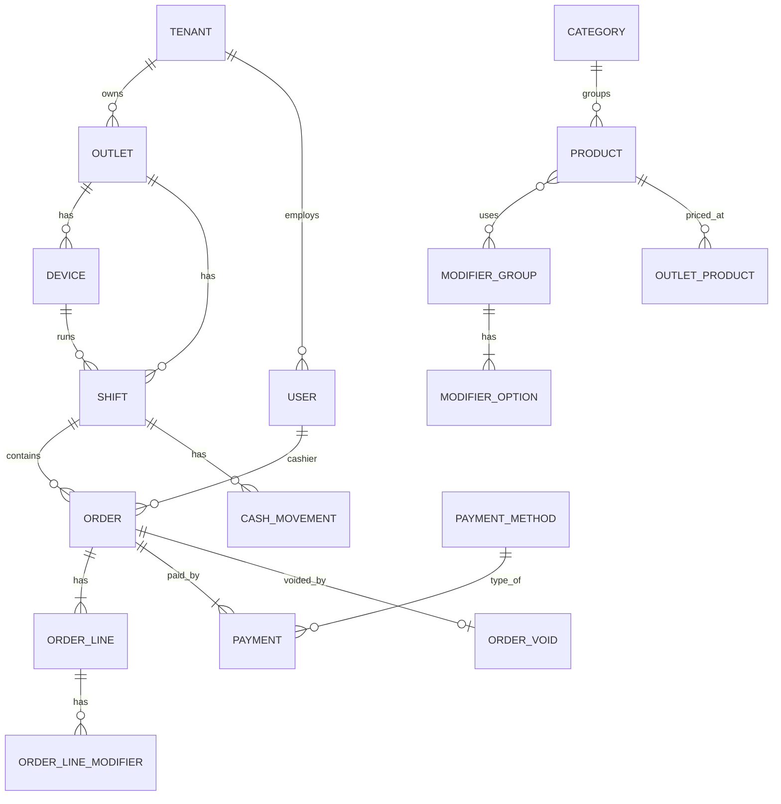

# 06 — Domain Model & Database

## Ubiquitous Language

| Istilah | Arti |
|---|---|
| **Tenant** | Satu bisnis pelanggan SaaS (mis. satu brand restoran). Semua data lain milik tepat satu tenant |
| **Outlet** | Satu cabang/toko fisik milik tenant |
| **Device** | Satu instalasi POS (tablet/PC) yang sudah diaktivasi untuk outlet |
| **Shift** | Sesi kasir di satu device: dibuka dengan modal awal, ditutup dengan hitung kas |
| **Order** | Transaksi penjualan (1 struk). Status: `paid` → (`voided`). Tidak ada order `open` di server: bill dine-in yang belum dibayar adalah **Open Bill** lokal device (ADR-015) |
| **Open Bill** | Pesanan dine-in yang disimpan dan belum dibayar, hanya di tablet yang membukanya; menjadi satu atau beberapa Order saat dibayar (split bill) |
| **Meja (Dining Table)** | Label meja per outlet (mis. "A1", area "Teras"); master data dari back-office |
| **Promo** | Aturan diskon otomatis (`percent_off`, `buy_x_get_y`) dengan cakupan produk/kategori/outlet dan jadwal; dievaluasi di device (ADR-016) |
| **Order Line** | Satu baris item: produk + qty + modifier + catatan (snapshot harga) |
| **Modifier** | Add-on/opsi (prototype: "add_ons"). Dikelompokkan dalam **Modifier Group** (mis. "Topping", "Level Gula") |
| **Payment** | Pembayaran untuk order; satu order bisa beberapa payment (split) |
| **Cash Movement** | Kas masuk/keluar di luar penjualan (mis. beli es batu, setor ke owner) |
| **Business Date** | Tanggal operasional outlet (bukan tanggal kalender) |
| **Basis poin (bps)** | Satuan tarif integer: `100` bps = 1%, `1000` = 10% |
| **Flag** | Tanda audit pada order yang tetap diterima server: `TOTAL_MISMATCH`, `RATES_OUTDATED` |

## Business Rules (invariants)

**Order**
1. Order `paid` hanya jika `sum(payments.amount) >= total` dan minimal 1 payment.
2. `change_amount = sum(cash payments) - (total - non-cash payments)`, ≥ 0. Non-cash tidak boleh melebihi sisa tagihan (tidak ada kembalian non-cash).
3. Order `paid` **immutable**. Koreksi hanya lewat void (butuh permission `order.void` + alasan).
4. Void hanya diperbolehkan pada business date yang sama & shift yang masih terbuka (konfigurasi); setelah itu → refund (fase lanjut).
5. Diskon persen = integer 0..100; diskon nominal = integer Rupiah. Diskon tidak boleh membuat subtotal < 0. **Diskon manual** (diskon baris tanpa promo + diskon order) di atas batas kasir **brand** — persen > `cashier_max_discount_percentage` atau total Rupiah per order > `cashier_max_discount_amount` (default 20% / Rp 50.000) — butuh approval PIN manager/owner di device; `order.placed` membawa `discount_approved_by`. Manajer/owner (permission `discount.override`) tidak butuh approval. Promo otomatis tidak dihitung. Server tidak menolak: tanpa approval yang sah → flag `DISCOUNT_UNAPPROVED`. Aturan dikunci fixture bersama `discount-approval-cases.json`. Preset pilihan diskon dan boleh-tidaknya nilai bebas juga diatur per brand.
6. Qty > 0, integer (MVP; qty desimal untuk produk timbang = fase lanjut).
7. Total dihitung dengan tarif **snapshot** yang disimpan di order (`service_rate_bps`, `tax_rate_bps`), memakai `divRoundHalfUp` / `div_round_half_up` (ADR-005, ADR-011).
8. Diskon **per baris**: paling banyak satu per baris (manual atau promo). `line_gross = (unit_price + modifiers_total) × qty`; persen → `divRoundHalfUp(line_gross × pct, 100)`, nominal → `min(value, line_gross)`.
9. Rumus total: `subtotal = Σ line_gross`; `item_discounts = Σ diskon baris`; diskon order dihitung dari `subtotal − item_discounts` (persen/nominal, dibatasi); `discount_amount = item_discounts + diskon order`; `net = subtotal − discount_amount`; lalu service & PB1 seperti biasa. Tanpa diskon baris, hasilnya sama persis dengan rumus lama. Brand dengan harga termasuk pajak (ADR-030): `total = net`, PB1 lalu service dihitung mundur dari `net`.

**Promo (ADR-016)**
1. `percent_off`: `percentage` 1..100 untuk baris yang masuk cakupan. `buy_x_get_y`: per baris, `gratis = floor(qty / (x + y)) × y` unit → diskon nominal `gratis × (unit_price + modifiers_total)`; wajib punya cakupan produk/kategori.
2. Cakupan: `product_ids` ∪ `category_ids` (keduanya kosong = semua produk, hanya untuk `percent_off`); `outlet_ids` kosong = semua outlet.
3. Jadwal (zona waktu outlet, saat bayar): `starts_on`/`ends_on` (tanggal, opsional), `days_of_week` (1 = Senin … 7 = Minggu, kosong = setiap hari), `start_time`/`end_time` (HH:MM, opsional, `end` eksklusif; `end < start` = melewati tengah malam dan bagian setelah tengah malam dihitung ke hari mulainya, mis. "Jumat 22:00–02:00" masih berlaku Sabtu 01:00).
4. Satu baris hanya satu diskon: diskon manual menggantikan promo; di antara promo yang dipilih dipilih diskon terbesar (seri → `id` terkecil).
5. Promo tidak otomatis: layar bayar menampilkan promo yang berjalan dan memotong minimal satu baris (urut hemat terbesar); promo hanya berlaku bila kasir memilihnya, lalu dicek ulang jadwalnya saat order dibuat.

**Open Bill & Split (ADR-015)**
1. Hanya dine-in; satu open bill per meja. Bill hidup di tablet pembuka dan tidak disinkronkan.
2. Bayar bill = `order.placed` (`order_type: dine_in`, `table_label`) lalu bill dihapus, dalam satu transaksi Dexie.
3. Split per item: pilih baris & qty → dibayar sebagai order sendiri (struk sendiri); sisa tetap di bill. Diskon order persen ikut ke tiap order hasil split; diskon order nominal hanya boleh saat seluruh bill dibayar.
4. Shift tidak bisa ditutup selama ada open bill.

**Pajak & Service (MVP)**
1. Tarif per outlet: `service_rate_bps` dan `tax_rate_bps` (PB1), masing-masing boleh 0.
2. `service = divRoundHalfUp(net × service_bps, 10000)`; `tax = divRoundHalfUp((net + service) × tax_bps, 10000)` — PB1 dihitung dari net + service.
3. Struk menampilkan baris Service dan PB1 hanya bila tarifnya > 0.

**Tenant**
1. Semua data (kecuali tabel global) milik tepat satu tenant; referensi lintas tenant dilarang.
2. Tenant `suspended` tetap boleh push penjualan; perubahan master data diblok.

**Shift**
1. Satu device hanya boleh punya satu shift `open`.
2. Order wajib berada di shift yang `open`.
3. Tutup shift: `expected_cash = opening_cash + cash_sales - cash_change + cash_in - cash_out`; kasir input `counted_cash`; `variance = counted - expected` dicatat (tidak diblok).

**Modifier**
1. Modifier Group punya `min_select`, `max_select` (mis. "Level Gula" min 1 max 1 → radio; "Topping" min 0 max 3 → checkbox). Menggantikan add-on flat di prototype.

## Aggregate & Entity Diagram



## Schema (ringkas)

Konvensi (PostgreSQL 16): PK `ulid` (`char(26)`), uang `BIGINT` (Rupiah), tarif `INTEGER` basis poin, timestamp `TIMESTAMPTZ` (UTC) + `timezone` di outlet. Tabel master punya `version BIGINT NOT NULL` (index, diisi trigger — ADR-009) + `deleted_at`.

**Multi-tenant (ADR-013)**: setiap tabel di bawah punya `tenant_id char(26) NOT NULL` + policy RLS, **kecuali** tabel global `tenants`, `roles`, `permissions`, `role_permissions`. Kolom `tenant_id` tidak ditulis ulang di daftar kolom di bawah agar ringkas. Unique constraint diawali `tenant_id`.

### Tenancy, Organization & Identity

```
tenants          id, slug (unik global), name, status (active|suspended), plan (nullable — Fase 5),
                 default_timezone, created_at, suspended_at                -- global, tanpa RLS
outlets          id, code (unik per tenant, mis. JKT01), name, address, phone, timezone,
                 business_day_cutoff (time, default 04:00), tax_rate_bps (int, mis. 1000),
                 service_rate_bps (int, mis. 500), receipt_header, receipt_footer,
                 service_mode (counter|table_service, ADR-031, migrasi 0027), version, timestamps, deleted_at
devices          id, outlet_id, code (A, B, …; unik per outlet), name, platform, app_version,
                 last_seen_at, activated_by, revoked_at, timestamps
users            id, name, email (unik global, nullable untuk kasir), password_hash (argon2, nullable), pin_hash, pin_salt,
                 pin_iterations, is_active, version, timestamps, deleted_at
brands           id, code (unik per tenant), name, logo_key, receipt_header, receipt_footer, is_active,
                 discount_percentages[], discount_amounts[], allow_custom_discount,
                 cashier_max_discount_percentage, cashier_max_discount_amount   -- migrasi 0020
                 price_includes_tax (bool, default false)                       -- ADR-030, migrasi 0024
                 version, timestamps, deleted_at           -- ubah → touch outlets.version (ADR-022)
user_assignments id, user_id, role_id, scope_type (company|brand|outlet), brand_id, outlet_id
                 -- CHECK owner hanya company, cashier bukan company; FK (outlet_id, brand_id) → outlets;
                 -- ubah → touch users.version (menggantikan outlet_user, migrasi 0016)
device_imports   id, device_id, imported_by, file_sha256, accepted, duplicate, flagged,
                 rejected (jsonb [{id, code}]), created_at   -- audit import darurat (ADR-024)
day_closings     id, outlet_id, business_date, closed_by, closed_at, notes, snapshot (jsonb)
                 -- UNIQUE (tenant_id, outlet_id, business_date); tutup hari (ADR-026)
roles            id, name (owner|manager|cashier|waiter — waiter tanpa permission, ADR-031)
permissions      id, name (mis. order.void, discount.override, shift.close, cash.move)
role_permissions role_id, permission_id                                    -- PK (role_id, permission_id)
api_tokens       id, owner_type (device|user|platform_admin), owner_id, token_hash (sha256, unik), abilities (text[]),
                 last_used_at, expires_at (nullable untuk device), revoked_at, created_at
platform_admins  id, email (unik lower()), name, password_hash (argon2), disabled_at, created_at
                 -- global, tanpa RLS, hanya poslite_system (migrasi 0008; disabled_at 0021)
platform_tokens  id, admin_id, token_hash (sha256, unik), expires_at, revoked_at, created_at
platform_audit_log id, admin_id, action, tenant_id (nullable, referensi), target_id, detail (jsonb), created_at
                 -- global, append-only (poslite_system hanya SELECT/INSERT), INDEX (tenant_id, created_at) — ADR-025
audit_logs       id, actor_type, actor_id, action, entity_type, entity_id, before (jsonb), after (jsonb),
                 device_id (nullable), created_at                           -- INDEX (entity_type, entity_id)
```

### Catalog & Payment

```
categories       id, name, sort_order, color, print_role (receipt|kitchen|bar), version, timestamps, deleted_at
products         id, category_id, sku (unik per tenant), name, description, image_key (key object storage, ADR-021), base_price, is_active, version, …
outlet_products  outlet_id, product_id, price (nullable → pakai base_price), is_available, version
modifier_groups  id, name, min_select, max_select, version, …
modifier_options id, modifier_group_id, name, price, sort_order, version, …
product_modifier_group  product_id, modifier_group_id, sort_order         -- ubah → touch products.version
dining_tables    id, outlet_id, label (unik per outlet), area, seats, sort_order, version, deleted_at
promotions       id, name, type (percent_off|buy_x_get_y), percentage, buy_qty, get_qty,
                 product_ids[], category_ids[], outlet_ids[], days_of_week[], start_time, end_time,
                 starts_on, ends_on, is_active, version, deleted_at
sales_channels   id, brand_id, code (unik per brand, huruf besar), name, kind (dine_in|take_away|delivery),
                 price_mode (base|markup_bps|price_list), markup_bps, markup_rounding_unit (≥ 1),
                 default_payment_method_id, applies_service, applies_tax, requires_external_ref,
                 is_active, sort_order, version, deleted_at                     -- ADR-029, migrasi 0025
channel_prices   channel_id, product_id (PK), price      -- link: ubah → touch sales_channels.version
open_bills       id, outlet_id, table_id (unik selama terbuka), table_label, lines (jsonb: baris cart device),
                 discount (jsonb), opened_by, opened_at, version (optimistic lock, bukan sync version),
                 lease_device_id, lease_user_id, lease_until, closed_at, closed_by_order_id, updated_at
                 -- ADR-031, migrasi 0027; hanya outlet table_service; RLS tenant
payment_methods  id, type (cash|debit|qris|credit_card|voucher|other), name, logo_url,
                 requires_reference (bool), sort_order, is_active, version, …
outlet_payment_method   outlet_id, payment_method_id                      -- ubah → touch payment_methods.version
```

### Sales & Shift (data dari device — immutable)

```
shifts           id (ulid dari device), outlet_id, device_id, opened_by, opened_at, opening_cash,
                 closed_by, closed_at, counted_cash, expected_cash, variance, status (open|closed),
                 business_date, synced_at
cash_movements   id, shift_id, type (in|out), amount, reason, created_by, created_at

orders           id (ulid), outlet_id, device_id, shift_id, receipt_no (unik per outlet),
                 cashier_id, business_date, order_type (take_away|dine_in), table_label (nullable, snapshot),
                 subtotal, discount_type, discount_value, discount_amount,
                 service_rate_bps, tax_rate_bps (snapshot tarif dari device),
                 price_includes_tax (snapshot mode harga, ADR-030),
                 channel_id (ADR-029, nullable untuk data lama; diisi migrasi 0026), external_ref (no. order aplikasi),
                 queue_no, customer_name (P1-1, migrasi 0028; hanya take away/delivery),
                 service_charge, tax, total, paid_amount, change_amount,
                 status (paid|voided), flags (text[], kosong = bersih), notes,
                 created_at (waktu device), synced_at (waktu server)
                 INDEX (outlet_id, business_date), INDEX (shift_id)
order_lines      id, order_id, product_id, product_name (snapshot), category_name (snapshot),
                 unit_price (snapshot), modifiers_total, quantity, line_total (gross), notes, sort_order,
                 discount_type, discount_value, discount_amount (diskon baris, 0 bila tidak ada),
                 promotion_id, promotion_name (snapshot promo, nullable)
order_line_modifiers  id, order_line_id, modifier_option_id, name (snapshot), price (snapshot)
payments         id, order_id, payment_method_id, method_type (snapshot), method_name (snapshot),
                 amount, reference (no. approval EDC / ref QRIS), created_at
order_voids      order_id (PK), device_id, reason, voided_by, approved_by, voided_at   -- ADR-023
refunds          id (ulid dari device), outlet_id, brand_id (trigger dari outlet), device_id, shift_id,
                 order_id, refund_no (unik per outlet), business_date (hari refund), reason,
                 refunded_by, approved_by, total, flags[], created_at, synced_at
refund_lines     id, refund_id, order_line_id, product_id, product_name (snapshot), quantity, amount
refund_payments  id, refund_id, payment_method_id, method_type, method_name, amount, reference
bill_voids       id (ulid dari device), outlet_id, brand_id (trigger dari outlet), device_id, shift_id,
                 business_date (hari batal), bill_id (id bill di device, tanpa FK — ADR-015),
                 scope (line|bill_cancelled), table_label, cashier_id, approved_by, reason, amount,
                 voided_at, synced_at                                                  -- ADR-028
                 INDEX (tenant_id, outlet_id, business_date)
bill_void_lines  id, void_id, product_id, product_name (snapshot), modifiers[] (nama), unit_price
                 (dengan pilihan), quantity, amount, sort_order
```

Semua tabel transaksi (`shifts`, `orders`, `refunds`, `bill_voids`, `rpt_*`) punya `brand_id` yang diisi trigger
`fill_brand_from_outlet()` dari outlet — server, bukan payload, yang menentukan brand (ADR-022).
Kategori, produk, grup pilihan, dan promo punya `brand_id` dari back-office (`X-Brand-Id`); outlet
punya `brand_id` tetap (tidak bisa pindah brand). Metode bayar tetap tingkat perusahaan; outlet yang
memakainya ada di `outlet_payment_method (outlet_id, payment_method_id)` (ubah → touch
`payment_methods.version`).

### Sync

```
sync_events      id (ulid event dari device), device_id, type, aggregate_id,   -- PK (tenant_id, id), migrasi 0006
                 status (accepted|flagged|rejected), error_code, payload (jsonb), attempts,
                 received_at, processed_at
                 INDEX (device_id, received_at)           -- rejected boleh diproses ulang
sync_version_seq SEQUENCE + trigger assign_sync_version() di tiap tabel master (ADR-009)
outbox_messages  id (ulid), topic (mis. sales.order_placed), payload (jsonb), created_at,
                 published_at (nullable), attempts, last_error
                 INDEX (published_at) WHERE published_at IS NULL
```

### Reporting (read model) — lihat [05](./05-backend-architecture.md#reporting-read-model)

## Mapping dari Prototype

| Prototype | Target |
|---|---|
| `Product.add_ons[]` | `modifier_groups` + `modifier_options` (dengan min/max) |
| `CartItem.selected_add_ons` | `order_line_modifiers` (snapshot) |
| `Transaction.id: number` | `orders.id` ULID + `receipt_no` |
| `payment_method: "debit-bca"` (string) | `payments.payment_method_id` + snapshot `method_type`, `method_name` |
| `discount {type, value}` | `orders.discount_type`, `discount_value`, `discount_amount` |
| `created_at: "2026-03-09"` | `created_at` (timestamp) + `business_date` |
