# 15 — Perbaikan UI/UX POS Kasir

Status per **2026-10-25**. Review UI dilakukan pada `poslite-web` di commit `2e675b2`. Dampak backend dicek ulang terhadap `poslite-api` dan `poslite-print-bridge` di commit `1cec242`, setelah P0-1 sampai P0-4 dan P1-1 sampai P1-3 di dokumen 14 selesai.

Dokumen ini khusus perbaikan **UI/UX aplikasi kasir**. Perbaikan fungsional dan operasional menuju pilot ada di [14 — Rencana Perbaikan Menuju Pilot](./14-pilot-readiness.md). Kaitan dengan dokumen 14 ditulis di setiap item.

## Cara Review

- Aplikasi di-build versi produksi (`pnpm build` + `next start`) dan dijalankan dalam **mode demo**.
- Alur lengkap disusuri di tiga ukuran layar, sama dengan project Playwright: **tablet landscape** (Galaxy Tab S9, 1280×800 CSS px), **tablet portrait** (iPad Pro 11), dan **HP** (Pixel 7). Alurnya: aktivasi → PIN → buka shift → jual dengan modifier → dine-in → simpan bill → bayar tunai → struk → riwayat → laporan → shift → printer.
- Temuan yang menyangkut perilaku dicek ulang di kode (file disebut di setiap item).
- Setiap item punya bagian **Backend** yang menyebut perubahan di `poslite-api` atau Print Bridge, atau menyatakan tidak ada perubahan.

## Tentang Mockup

- Mockup ada di [`assets/15-ui-ux/`](./assets/15-ui-ux/). File `before-*.png` adalah tangkapan layar aplikasi sekarang, sedangkan `mockup-*.png` adalah usulan.
- Mockup adalah **referensi arah desain**, bukan spesifikasi piksel. Tetap pakai komponen shadcn/ui dan token warna yang sudah ada di `globals.css`.
- Lingkaran kuning bernomor (①②③) di mockup dijelaskan di bagian "Penanda" setiap item.
- Data di mockup fiktif (brand contoh "Sushi Maru", outlet Dago) supaya terasa seperti menu restoran nyata.
- Sumber HTML mockup ada di [`assets/15-ui-ux/src/`](./assets/15-ui-ux/src/). Buka di Chrome dengan ukuran jendela 1280×800 (HP: 390×844) untuk melihat atau mengubahnya.

---

## 1. Ringkasan & Prioritas

| ID | Perbaikan | Prioritas | Estimasi UI* | Backend | Kaitan dengan 14 |
|---|---|---|---|---|---|
| UX-01 | Status sync selalu terlihat + banner mode demo | **Tinggi** | 1–2 hari | Tidak ada | P1-7 |
| UX-05 | Dialog batal bill dengan alasan + PIN manajer | **Tinggi** | 1–1,5 hari | Tidak ada (sudah di P0-1) | P0-1 ✅ |
| UX-02 | Tutup shift dengan hitung buta (blind count) per pecahan | **Tinggi** | 2 hari | **Ada**: migrasi `0032`, payload `shift.closed`, `blind_close` (±1,5 hari) ✅ | P1-3 ✅ |
| UX-03 | Layar Bayar: keypad selalu terlihat, metode bayar dikelompokkan, cetak otomatis | **Tinggi** | 2 hari | Tidak ada | P1-3 ✅, P0-2 ✅ |
| UX-04 | Layar Meja dengan status meja | **Tinggi** | 2–3 hari | **Ada**: migrasi `0033`, field open bill (±1 hari) | P0-4 ✅ |
| UX-06 | Layar Jual: mode ringkas, jenis pesanan di awal, status baris dapur | Menengah | 3 hari | Tidak ada | P0-2 ✅, P1-1 ✅, P1-2 ✅ |
| UX-07 | Posisi dan perilaku toast | Menengah | 0,5 hari | Tidak ada | — |
| UX-08 | Pengaturan printer khusus manajer dengan wizard | Menengah | 2 hari | **Print Bridge**: `GET /discover` (±1 hari) | P1-5, P1-6 |
| UX-09 | Mode daftar untuk HP pelayan | Menengah | 1–2 hari | Tidak ada (sudah di P0-4) | P0-4 ✅ |
| UX-10 | Label laporan & ringkasan kas shift | Rendah | 0,5 hari | Tidak ada | P0-1 ✅, P0-2 ✅ |
| UX-11 | Identitas visual & layar kunci (brand + outlet) | Rendah | 1 hari | Tidak ada | — |

\* Estimasi untuk 1 developer + coding agent dengan TDD. Kolom "Backend" menyebut pekerjaan di luar `poslite-web` beserta estimasinya.

Tabel di atas sudah diurutkan menurut urutan pengerjaan yang disarankan. Detail urutan dan alasannya ada di §5.

### 1.1 Ringkasan Dampak Backend

| Item | Repo | Perubahan | Urutan deploy |
|---|---|---|---|
| UX-02 | `poslite-api` | Migrasi `0032_blind_close`: kolom `shifts.denominations` (JSONB, nullable) dan `brands.blind_close` (boolean, default `true`). Field opsional `denominations` di `ShiftClosedPayload` (total ≠ `counted_cash` → `DENOMINATIONS_MISMATCH`). `denominations` di detail shift (`ShiftDetailOut`). `blind_close` ikut `outlet_setting`. ✅ | **API dulu.** `ShiftClosedPayload` memakai `extra="forbid"`, jadi POS yang mengirim `denominations` ke API lama akan ditolak dan event-nya menjadi `dead` di outbox. |
| UX-02 | `poslite-admin` | Toggle "Hitung buta saat tutup shift" di pengaturan brand; rincian pecahan di detail shift. | Setelah API. |
| UX-04 | `poslite-api` | Migrasi `0033_open_bill_guests_printed`: kolom `open_bills.guest_count` dan `open_bills.printed_at`, ikut di API open bill. Bila rata-rata per tamu masuk laporan: `orders.guest_count` dan field opsional `guest_count` di `OrderPlacedPayload` (juga `extra="forbid"`). | **API dulu**, alasan sama. |
| UX-08 | `poslite-print-bridge` | Endpoint baru `GET /discover` (pindai port 9100 di subnet lokal, butuh pairing). Bridge sekarang hanya punya `/health`, `/pair`, `/print`. | Bridge dulu; POS menyembunyikan tombol "Cari printer" bila bridge tidak punya endpoint ini. |

Yang **sudah ada** di backend dan tidak perlu diubah:

- Audit batal bill dengan `reason` dan `approved_by` (`bill_voids`, P0-1) untuk UX-05.
- Channel penjualan, nama pelanggan/nomor antrian, menu habis, dan pembulatan tunai untuk UX-03 dan UX-06.
- Shared open bill dengan lease (ADR-031, `open_bills`) dan peran `waiter` untuk UX-04 dan UX-09.
- Area meja (`dining_tables.area`) untuk tab area di UX-04.
- Kolom `service`, `tax`, `pre_payment_void_*`, `cash_rounding`, dan laporan per channel untuk UX-10.
- Logo brand (`brands.logo_key`, sampai di device sebagai `logoKey`) untuk UX-11.

## 2. Prinsip Desain untuk Lantai Restoran

Prinsip ini dipakai untuk menilai semua layar di dokumen ini dan layar baru ke depan.

1. **Terbaca dalam 3 detik.** Kasir melihat layar sambil melayani tamu. Status penting (sync, meja, kembalian) harus terbaca tanpa membaca kalimat.
2. **Satu aksi utama per layar.** Hanya satu tombol hijau penuh. Aksi lain berupa tombol outline.
3. **Aksi berbahaya dipisah dan diberi warna.** Batal, void, dan refund berwarna merah, letaknya terpisah dari aksi biasa, dan selalu meminta alasan bila menyangkut uang atau bahan yang sudah keluar.
4. **Tampilan menurut peran.** Kasir tidak melihat angka yang bisa dipakai untuk menutupi selisih (expected cash), dan tidak melihat pengaturan teknis.
5. **Kecepatan di atas keindahan.** Foto menu itu bagus untuk demo, tetapi mode ringkas lebih cepat di jam sibuk. Sediakan keduanya.
6. **Target sentuh minimal 44×44 px**, jarak antar tombol minimal 8 px, dan teks utama minimal 14 px.
7. **Bahasa operasional, bukan teknis.** "Wi-Fi / Kabel LAN", bukan "Printer LAN Epson (ePOS)". "Tersinkron", bukan "Online".

---

## 3. Detail Perbaikan

### UX-01 — Status Sync Selalu Terlihat + Banner Mode Demo

**Status: selesai** (branch `feat/ux-01-sync-status`). Catatan implementasi:

- Baris identitas di header memakai kode device (`Perangkat A`), karena nama device belum disimpan di data lokal.
- Badge `DEMO` tidak bisa ditekan; banner demo sudah menjelaskan statusnya.
- "Keluar dari demo" meminta konfirmasi, menghapus data demo, mengunci sesi, lalu membuka `/activate`. Fungsi ini menolak menghapus device yang sudah diaktifkan.
- Cek badge kuning → hijau ada di `tests/fullstack/activate-sell-sync.spec.ts` (butuh API lokal), bukan di `offline.spec.ts`, karena device demo tidak pernah sync.

**Masalah**

- Header menampilkan **"Online"** (status internet). Di mode demo, badge ini tetap hijau "Online" padahal tidak ada data yang dikirim ke server. Di Riwayat, order berstatus "Pending" di saat yang sama.
- `SyncBadge` (`features/sync/components/SyncBadge.tsx`) sebenarnya sudah ada, tapi hanya muncul bila ada antrean atau gagal, dan sengaja disembunyikan di mode demo. Jadi saat kondisi normal, kasir tidak pernah melihat konfirmasi bahwa datanya aman.
- Mode demo tidak punya penanda sama sekali. Tombol "Coba mode demo" juga ada di layar aktivasi device produksi. Kasir bisa tanpa sengaja berjualan berhari-hari di mode demo, dan transaksinya tidak pernah sampai ke owner.

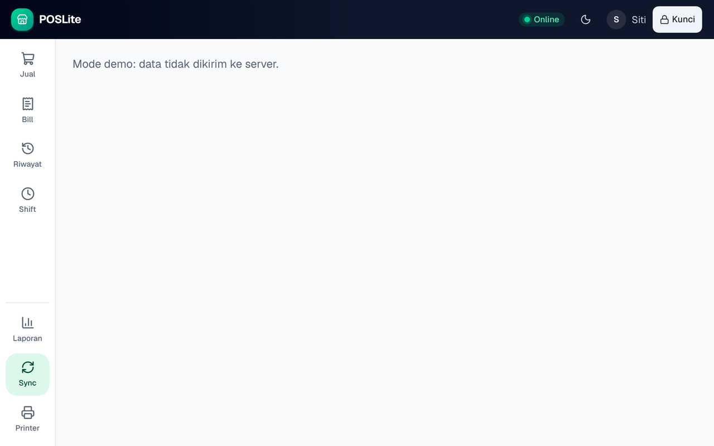 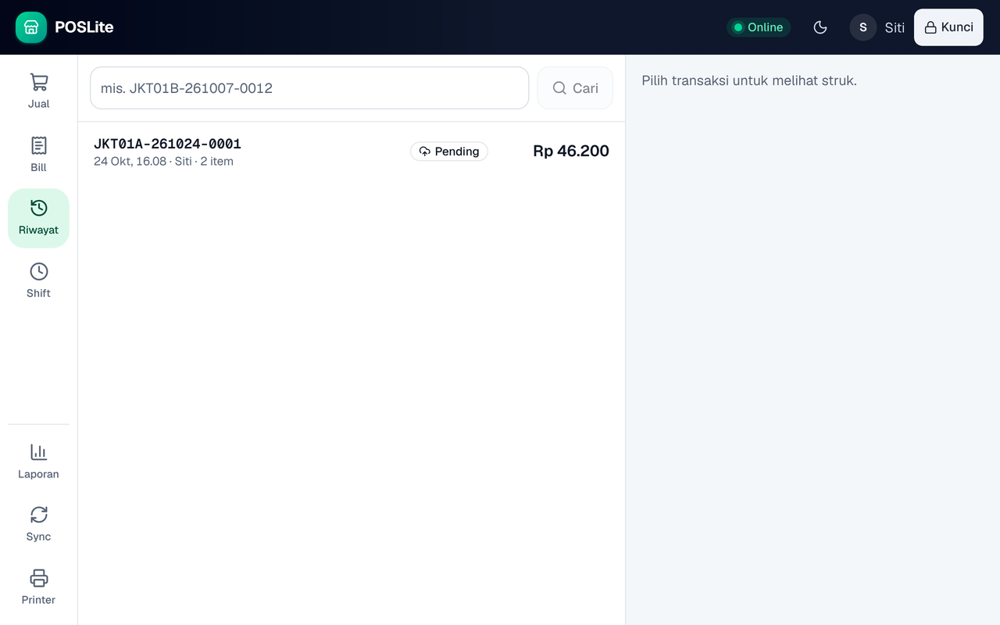

**Usulan**

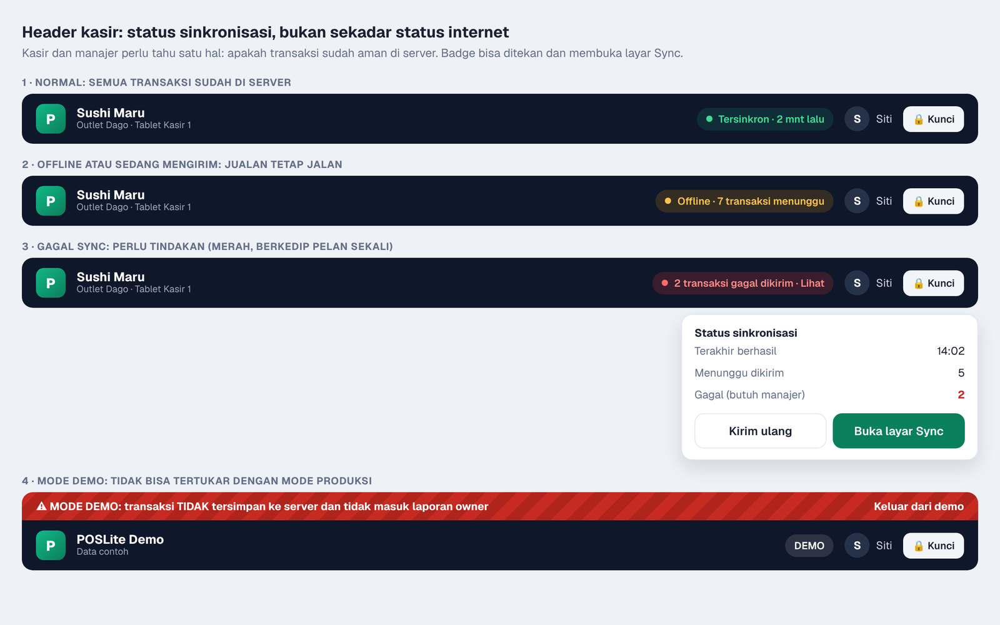

**Spesifikasi**

1. Gabungkan badge "Online" dan `SyncBadge` menjadi **satu badge status sync** yang selalu tampil dan bisa ditekan. Kondisi dicek **dari atas ke bawah**; kondisi pertama yang cocok yang ditampilkan:

   | Urutan | Kondisi | Teks | Warna |
   |---|---|---|---|
   | 1 | Ada outbox `dead` | `{n} transaksi gagal dikirim · Lihat` | merah |
   | 2 | Ada antrean dan push sukses terakhir > 2 jam lalu | `Belum sync sejak {jam}` | merah |
   | 3 | Offline atau ada antrean | `Offline · {n} transaksi menunggu` / `Mengirim {n}…` | kuning |
   | 4 | Tidak ada antrean, push terakhir berhasil | `Tersinkron · {n} mnt lalu` | hijau |

2. Menekan badge membuka popover berisi waktu sukses terakhir, jumlah menunggu, jumlah gagal, tombol **Kirim ulang**, dan tombol **Buka layar Sync**.
3. Di **mode demo**: banner merah bergaris di atas header bertuliskan "MODE DEMO: transaksi TIDAK tersimpan ke server dan tidak masuk laporan owner", ditambah tautan "Keluar dari demo". Badge sync diganti menjadi `DEMO`.
4. Tombol "Coba mode demo" di `/activate` hanya muncul bila `NEXT_PUBLIC_DEMO_ENABLED=true`. Matikan untuk deployment produksi tenant, dan nyalakan untuk situs demo penjualan.
5. Brand dan outlet aktif tampil di bawah logo (`Sushi Maru · Outlet Dago · Tablet Kasir 1`). Ini penting untuk multi-brand (ADR-022).

**Backend**: tidak ada. Semua status berasal dari outbox dan `syncState` di Dexie. Tambahkan `NEXT_PUBLIC_DEMO_ENABLED` di konfigurasi deploy (`deploy/`) untuk tiap environment.

**File terdampak**: `app/(pos)/pos-header.tsx`, `features/sync/components/SyncBadge.tsx`, `features/sync/application/use-sync-status.ts`, `app/activate/*`.

**DoD**: test komponen untuk keempat kondisi badge, termasuk urutannya (ada `dead` dan antrean sekaligus → merah "gagal dikirim"); e2e `offline.spec.ts` memeriksa badge berubah ke kuning saat offline dan kembali hijau setelah outbox kosong; e2e demo memeriksa banner tampil di semua layar POS.

---

### UX-02 — Tutup Shift dengan Hitung Buta (Blind Count)

**Masalah**

- Layar Shift menampilkan **"Seharusnya di laci"** kepada kasir sebelum ia menghitung uang.
- `CloseShiftDialog.tsx` menampilkan `expectedCash` dan menghitung selisih **secara langsung** saat kasir mengetik. Kasir bisa menyesuaikan angka hitungannya sampai selisih menjadi nol. Ini celah anti-fraud yang paling sering ditanyakan owner restoran.
- Ringkasan kas membingungkan: "Penjualan tunai Rp 50.000" lalu "Kembalian −Rp 3.800". Yang dipahami kasir adalah uang bersih yang masuk, Rp 46.200.

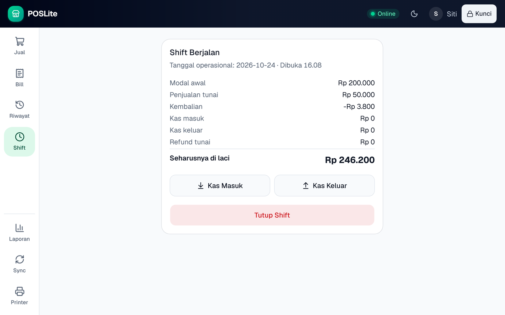

**Usulan**

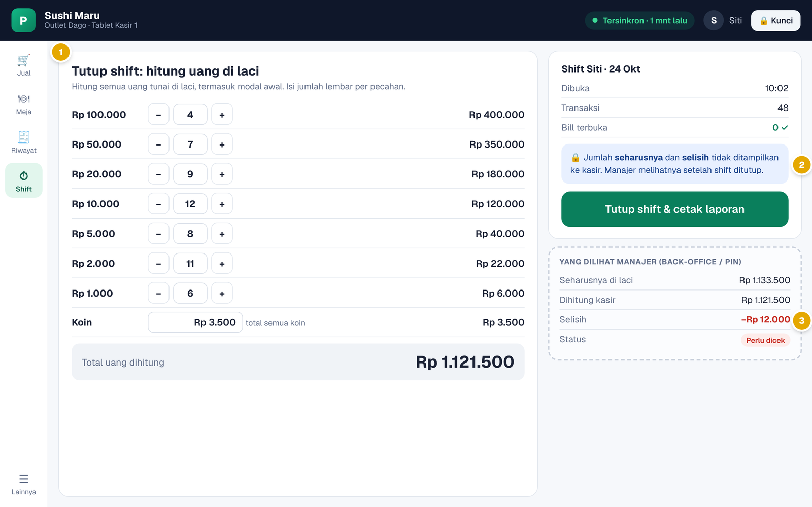

**Penanda**

1. Form hitung **per pecahan** (Rp 100.000 sampai Rp 1.000, ditambah total koin). Total dihitung otomatis. Pecahan mengurangi salah hitung dan mempercepat proses.
2. Untuk peran **kasir**, angka seharusnya dan selisih **tidak ditampilkan** sama sekali, baik sebelum maupun sesudah tutup shift. Yang ditampilkan hanya jumlah transaksi dan bill terbuka.
3. Angka seharusnya, hasil hitung, selisih, dan status hanya terlihat oleh **manajer**: di back-office, atau di POS setelah PIN manajer.

**Spesifikasi**

- Domain tidak berubah: `closeShiftCash(expected, counted)` tetap menghitung variance, dan event `shift.closed` tetap membawa `expected_cash`, `counted_cash`, `variance`. Yang berubah hanya apa yang ditampilkan.
- Tambahkan `denominations: Record<number, number>` (opsional) di payload `shift.closed` supaya manajer bisa melihat rinciannya.
- `ShiftOverview` untuk kasir: tampilkan modal awal, jumlah transaksi, kas masuk/keluar, dan refund tunai. **Sembunyikan** "Seharusnya di laci".
- Pengaturan per brand `blind_close: boolean` (default `true`). Beberapa warung kecil mungkin ingin mematikannya.
- Struk laporan tutup shift yang dicetak untuk kasir juga **tidak** memuat expected/variance.
- Pembulatan tunai (14 · P1-3, sudah selesai) sudah masuk ke perhitungan expected cash. Pastikan tetap begitu setelah perubahan ini.
- Persetujuan manajer di POS memakai `ManagerApproval` dari UX-05.

**Backend** (detail di §1.1)

**Status: selesai.** Backend di branch `feat/ux-02-blind-close-api`, POS di `feat/ux-02-blind-close-pos`. Catatan implementasi POS:

- Dalam hitung buta, kasir juga tidak melihat **penjualan tunai** dan **kembalian**, karena dari keduanya ditambah modal dan kas masuk/keluar, kas seharusnya bisa dihitung. Layar Shift kasir menampilkan modal awal, jumlah transaksi, kas masuk, kas keluar, dan refund tunai.
- Manajer yang login melihat semuanya. Kasir bisa membuka kas seharusnya lewat tombol "Lihat kas seharusnya" dan PIN manajer (`ManagerApproval`).
- Brand dengan `blind_close` mati tetap memakai satu total (keypad) dengan kas seharusnya dan selisih.
- Slip cetak tutup shift belum ada di kode, jadi tidak ada yang perlu disembunyikan di sana.
- Fixture bersama `sync-events.json` belum memuat `denominations` (event `shift.closed` yang sama dipakai test API untuk kasus tanpa pecahan); kontraknya dites di masing-masing sisi.
- e2e baru: `tests/e2e/shift-close-blind.spec.ts` di keempat layout.

Catatan implementasi backend:

- `poslite-api`, migrasi `0032_blind_close`:
  - `shifts.denominations` JSONB nullable.
  - `brands.blind_close` boolean default `true`, ikut delta pull brand dan bisa diubah di back-office.
  - **Tidak ada permission baru.** Usulan awal `shift.variance.view` dibatalkan: back-office hanya untuk owner/manajer, dan di POS rincian dibuka dengan PIN manajer lewat `ManagerApproval` (UX-05), yang memeriksa peran secara lokal. Permission itu tidak akan diperiksa di mana pun.
  - Koin dikirim sebagai `"1": <total koin dalam Rupiah>`, karena form POS meminta total koin, bukan jumlah keping.
- `ShiftClosedPayload` di `sync/application/events.py`: field opsional `denominations` (key = nominal pecahan, value = jumlah lembar ≥ 0). Validasi: total pecahan sama dengan `counted_cash`.
- `ShiftDetailOut` di `shift/presentation/router.py`: tambah `denominations` (daftar shift tidak berubah).
- `poslite-admin`: toggle `blind_close` dan tampilan rincian pecahan di detail shift.
- **Urutan deploy**: API dulu, baru POS. Payload memakai `extra="forbid"`.
- Webhook integrasi `shift.closed` tidak berubah.
- Perubahan kontrak API: perbarui `07-api-contract.md` dan `openapi.json` (AGENTS.md §10).

**File terdampak**

- Web: `features/shift/components/CloseShiftDialog.tsx`, `ShiftOverview.tsx`, `features/shift/domain/shift-cash.ts` (fungsi total pecahan), `features/printing` (slip tutup shift).
- API: `shift/domain/entities.py`, `shift/application/handlers.py`, `shift/infrastructure/models.py`, `shift/presentation/router.py`, `sync/application/events.py`, `organization` (pengaturan brand), `migrations/versions/0032_*`.

**DoD**

- Test komponen memastikan kasir **tidak** melihat expected/variance di mana pun (layar, dialog, toast "Shift ditutup", slip). Toast sekarang (`copy.closed(variance)`) juga membocorkan selisih, jadi ganti menjadi "Shift ditutup".
- Test API: push `shift.closed` dengan dan tanpa `denominations` diterima; total pecahan yang tidak sama dengan `counted_cash` ditolak (`DENOMINATIONS_MISMATCH`); di POS, rincian hanya terbuka setelah PIN manajer.

---

### UX-03 — Layar Bayar

**Status: selesai** (branch `feat/ux-03-checkout`). Catatan implementasi:

- Viewport project Playwright `tablet` (Galaxy Tab S9) adalah **1024×640** CSS px, bukan 1280×800. Layout diukur di ukuran itu, termasuk banner demo.
- Grup dengan satu metode memakai nama metodenya (mis. "GrabFood Voucher"); grup berisi beberapa metode memakai "Kartu ▸" / "Lainnya ▸" dan menyebut metode yang dipilih ("Kartu · Debit Mandiri").
- Nama pelanggan dan nomor pesanan ojol pindah ke kolom pesanan (kiri), supaya panel bayar cukup untuk keypad.
- Dua kolom di panel bayar aktif lewat container query mulai lebar 448 px (`@md`), bukan breakpoint `lg`, sehingga tablet portrait juga mendapatkannya. HP tetap bertumpuk; di sana hanya "Selesaikan" yang dijamin terlihat.
- "Pisah bayar" tetap di baris ringkasan, tidak dipindah ke grid keypad.
- Nominal cepat tidak diubah: tetap 4 tombol (uang pas lalu pembulatan ke 5.000/10.000/20.000/50.000/100.000, diisi kelipatan 50.000), karena 2×2 pas di kolom kiri.
- Cetak otomatis disimpan di `syncState.autoPrintReceipt` (tanpa versi Dexie baru), default mati.

**Masalah**

- Di tablet landscape (target utama), **keypad tunai terpotong** oleh panel ringkasan yang menempel di bawah. Hanya baris "1 2 3" yang terlihat setengah, sehingga kasir harus scroll untuk mengetik nominal yang tidak tersedia di tombol cepat.
- Panel kiri (ringkasan order) menyisakan ruang kosong besar, sementara panel kanan sesak.
- Sepuluh metode bayar tampil rata (Tunai, QRIS, 4 debit, Visa, Mastercard, GrabFood Voucher, GoFood Voucher). Akibatnya kasir harus memindai banyak tombol, dan metode ojol tercampur dengan pembayaran tamu.
- "Pisah pembayaran" terlihat seperti tombol nonaktif.
- Cetak struk selalu manual.

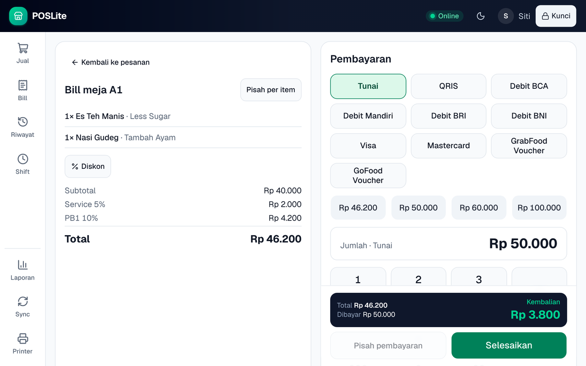

**Usulan**

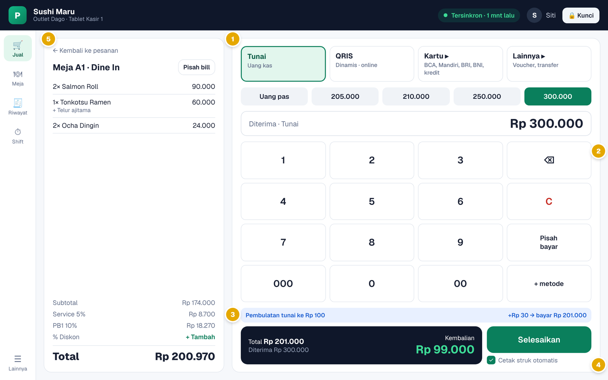

**Penanda**

1. Metode bayar dikelompokkan menjadi **4 tombol**: Tunai, QRIS, Kartu ▸ (sub-pilihan bank/kredit), dan Lainnya ▸ (voucher, transfer). Pembayaran ojol tidak lagi di sini, karena sudah ditentukan oleh channel (14 · P0-2, sudah selesai).
2. **Keypad selalu terlihat tanpa scroll** di 1280×800. Tombol "Pisah bayar" dan "+ metode" masuk ke grid keypad.
3. Baris **pembulatan tunai** (14 · P1-3, sudah selesai) muncul di atas ringkasan bila outlet memakainya.
4. Toggle **"Cetak struk otomatis"**, disimpan per device. Bila aktif, struk langsung dicetak setelah Selesaikan, dan dialog sukses tetap menampilkan kembalian.
5. Panel ringkasan dipersempit (±380 px) dan rincian item dipadatkan. Panel bayar mendapat ruang lebih besar.

**Spesifikasi**

- Layout grid `380px 1fr` untuk `lg` (landscape); portrait dan HP memakai layout sekarang yang sudah baik.
- Tombol nominal cepat: "Uang pas", lalu pembulatan ke atas ke 5.000 / 10.000 / 50.000 / 100.000 berikutnya (maksimal 5 tombol, tanpa duplikat).
- Ringkasan bawah (gelap) tetap menempel di bawah, tapi tingginya ≤ 96 px.
- Kartu ▸ membuka sheet kecil berisi daftar metode tipe `card` dari master data outlet. Bila hanya ada satu metode di grup itu, langsung pilih tanpa sheet.

**Backend**: tidak ada. Pengelompokan memakai tipe metode bayar yang sudah ada di master data; pembulatan tunai sudah dikirim di `order.placed`.

**File terdampak**: `features/checkout/components/CheckoutScreen.tsx`, `PaymentPanel.tsx`, `OrderReview.tsx`, `OrderPlacedDialog.tsx`, `features/printing` (auto print).

**DoD**: Playwright project `tablet` memeriksa tombol keypad "7" dan "Selesaikan" ada di viewport tanpa scroll (`toBeInViewport()`); test auto print memakai fake driver.

---

### UX-04 — Layar Meja dengan Status Meja

**Masalah**

- Pemilih meja hanya berupa daftar label (A1–B2) tanpa status. Kasir tidak bisa melihat meja mana yang terisi, berapa lama, dan berapa nilainya.
- Layar "Bill Terbuka" hanya berupa satu kartu di layar lebar yang kosong, terpisah dari konsep meja.
- Tombol **Batalkan** tampil setara dengan **Pindah**, tanpa warna destruktif (lihat UX-05).

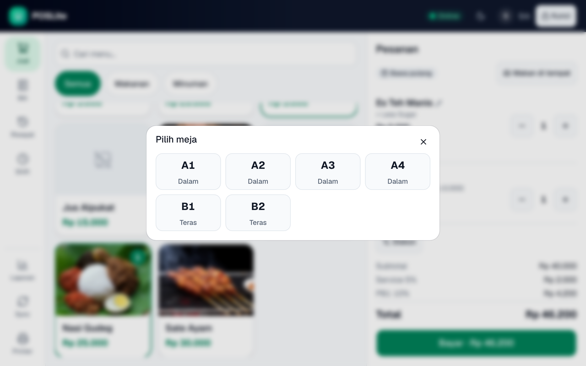 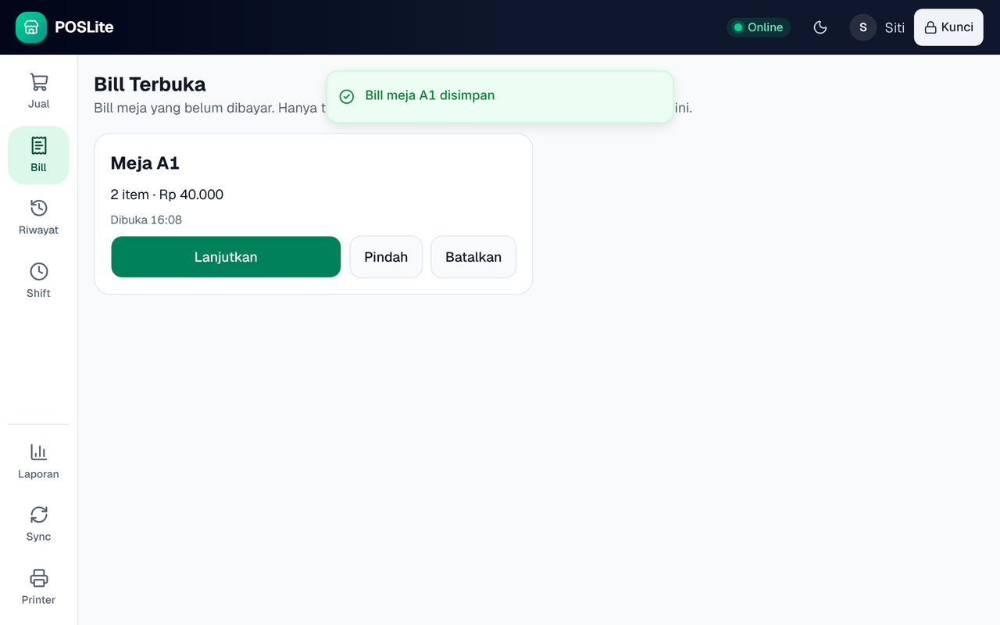

**Usulan**

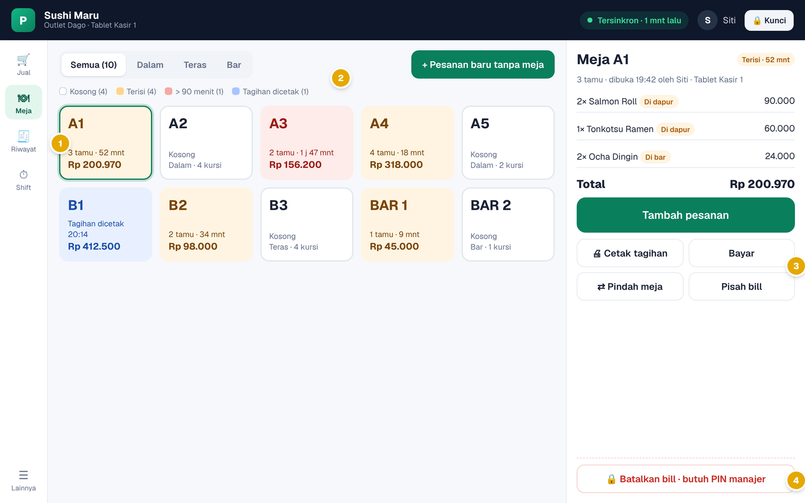

**Penanda**

1. Grid meja per area (tab Semua / Dalam / Teras / Bar) dengan warna status: **Kosong** (putih), **Terisi** (kuning, ada jumlah tamu, durasi, dan total), **> 90 menit** (merah, ambang bisa diatur per outlet), **Tagihan dicetak** (biru).
2. Legenda dengan jumlah per status, ditambah tombol "Pesanan baru tanpa meja" untuk take away.
3. Panel detail meja terpilih: item dengan status dapur/bar, aksi utama **Tambah pesanan**, lalu aksi sekunder Cetak tagihan, Bayar, Pindah meja, dan Pisah bill.
4. **Batalkan bill** dipisah di bagian bawah dengan garis putus-putus, berwarna merah outline, dan bertanda "butuh PIN manajer".

**Spesifikasi**

- Layar ini menggantikan menu **Bill** di rail menjadi **Meja**. `TablePicker` di layar Jual memakai komponen grid yang sama dalam bentuk dialog.
- **Urutan status** bila beberapa kondisi berlaku sekaligus: **> 90 menit** (merah) > **Tagihan dicetak** (biru) > **Terisi** (kuning) > **Kosong**. Meja yang tagihannya sudah dicetak tetapi melewati ambang tetap merah, dengan ikon struk kecil sebagai penanda tambahan.
- Tab area diambil dari `dining_tables.area` (sudah ada). Meja tanpa area masuk tab "Semua" saja.
- Sumber data mengikuti mode layanan outlet (ADR-031):
  - **`table_service`**: status meja dari open bill server, jadi semua device melihat status yang sama.
  - **`counter`**: status hanya dari open bill **di tablet ini** (ADR-015). Tampilkan keterangan kecil "Status meja dari tablet ini".
- Field baru di open bill: `guestCount` (jumlah tamu, opsional, diisi saat membuka bill) dan `billPrintedAt`. Keduanya tidak diindeks, jadi tidak perlu versi Dexie baru.

**Backend** (detail di §1.1)

- `poslite-api`, migrasi `0033_open_bill_guests_printed`: `open_bills.guest_count` (smallint nullable) dan `open_bills.printed_at` (timestamptz nullable), ikut di request/response API open bill. Tanpa ini, outlet `table_service` kehilangan jumlah tamu dan status "Tagihan dicetak" saat bill dibuka di device lain.
- Bila rata-rata per tamu masuk laporan: tambah `orders.guest_count` dan field opsional `guest_count` di `OrderPlacedPayload`. Bisa ditunda setelah pilot; jumlah tamu di layar meja tidak bergantung pada ini.
- **Urutan deploy**: API dulu (payload `extra="forbid"`).

**File terdampak**

- Web: `features/bills/components/BillsScreen.tsx`, `OpenBillList.tsx`, `TablePicker.tsx`, `DineInBar.tsx`, `app/(pos)/pos-nav.tsx`, `shared/db/rows.ts`.
- API: `sales/infrastructure/models.py` (`OpenBillModel`), `sales/presentation/open_bills.py`, `migrations/versions/0033_*`.

**DoD**

- e2e `dine-in-offline.spec.ts` diperbarui: meja A1 berubah dari Kosong ke Terisi setelah simpan bill, dan kembali Kosong setelah dibayar.
- e2e dua device (outlet `table_service`): jumlah tamu dan status "Tagihan dicetak" dari device A terlihat di device B.
- Test komponen untuk urutan status (meja > 90 menit dan sudah dicetak → merah).

---

### UX-05 — Dialog Batal Bill (Alasan + PIN Manajer)

Ini adalah sisi UI dari **14 · P0-1 (ADR-028)**, yang domain dan backend-nya sudah selesai. Aturan domain dan event ada di dokumen 14.

**Status: selesai** (branch `feat/ux-05-cancel-bill-dialog`). Catatan implementasi:

- `ManagerApproval` (`features/auth`) memakai `checkManagerPin`, satu-satunya pengecek PIN manajer: diskon, void, refund, batal bill, dan export darurat. PIN salah dihitung ke lockout device, dan saat terkunci pesannya sama dengan layar kunci.
- `BillVoidDialog` tetap menerima daftar penyetuju dan pengecek lewat props (mudah dites); `useBillVoid` mengisinya dengan `checkManagerPin`.
- Daftar alasan batal sebelum bayar (`bills/domain/void-reasons.ts`) terpisah dari alasan void/refund order yang sudah dibayar. Server tidak berubah karena `reason` tetap teks bebas.
- Bill tanpa item terkirim sudah memakai konfirmasi sederhana sejak P0-1, jadi tidak diubah.

**Usulan**

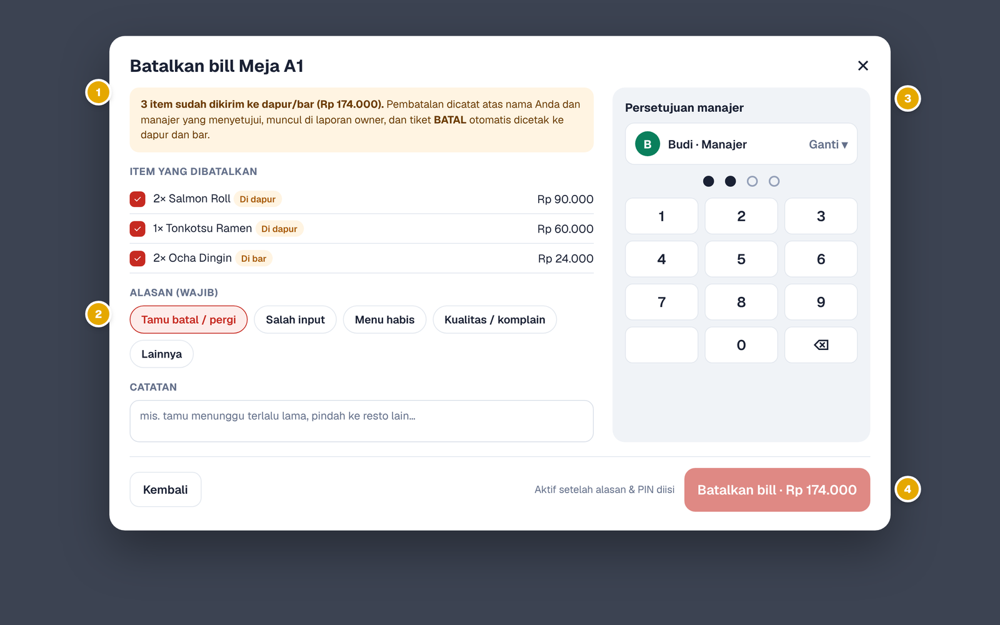

**Penanda**

1. Kotak peringatan menyebut jumlah item dan nilai yang sudah ke dapur/bar, siapa yang tercatat, bahwa pembatalan muncul di laporan owner, dan bahwa tiket **BATAL** dicetak otomatis.
2. **Alasan wajib** berupa pilihan baku (Tamu batal/pergi, Salah input, Menu habis, Kualitas/komplain, Lainnya). "Lainnya" mewajibkan catatan.
3. **Persetujuan manajer** di dalam dialog yang sama (pilih manajer + PIN). Kasir tidak perlu pindah layar.
4. Tombol merah menyebut nilainya ("Batalkan bill · Rp 174.000") dan baru aktif setelah alasan dan PIN valid.

**Spesifikasi**

- Dialog yang sama dipakai untuk **mengurangi qty baris yang sudah di dapur** (judul: "Batalkan 1× Salmon Roll").
- Bill tanpa baris terkirim: cukup konfirmasi sederhana tanpa PIN.
- Ekstrak komponen `ManagerApproval` dari `DiscountApproval.tsx` / void-refund agar perilakunya konsisten (lockout, pesan salah PIN). Komponen ini juga dipakai UX-02, jadi kerjakan UX-05 lebih dulu.
- Alasan baku dikirim sebagai teks di field `reason` yang sudah ada.

**Backend**: tidak ada. `bill.item_voided` dan tabel `bill_voids` sudah menyimpan `reason` dan `approved_by`. Opsional setelah pilot: kolom `reason_code` agar laporan kebocoran (14 · P2-2) bisa dikelompokkan per alasan. Sekarang `reason` masih teks bebas `String(200)`.

**DoD**: mengikuti DoD 14 · P0-1, ditambah test komponen `ManagerApproval` (lockout, salah PIN) yang dipakai ulang oleh diskon, void, refund, dan batal bill.

---

### UX-06 — Layar Jual

**Masalah**

- Grid menu hanya **3 kolom × 2 baris (6 menu per layar)** di tablet landscape karena foto sangat besar. Restoran umumnya punya 50–200 menu, sehingga kasir harus banyak scroll.
- Menu tanpa foto memakai ikon "gambar rusak" yang terlihat seperti error.
- Pilihan **Bawa pulang / Makan di tempat** ambigu: sulit menebak mana yang aktif. Pilihan ini juga ada di akhir alur, padahal di restoran jenis pesanan ditentukan lebih dulu.
- Tautan **"Diskon item"** muncul di setiap baris keranjang. Ini menambah kebisingan visual dan secara tidak langsung mengundang kasir memberi diskon.
- Untuk dine-in, tombol utama tetap **Bayar**, sedangkan "Simpan bill" (yang juga mengirim ke dapur) hanya tombol sekunder di pojok.
- Tidak terlihat baris mana yang sudah ke dapur dan mana yang baru.

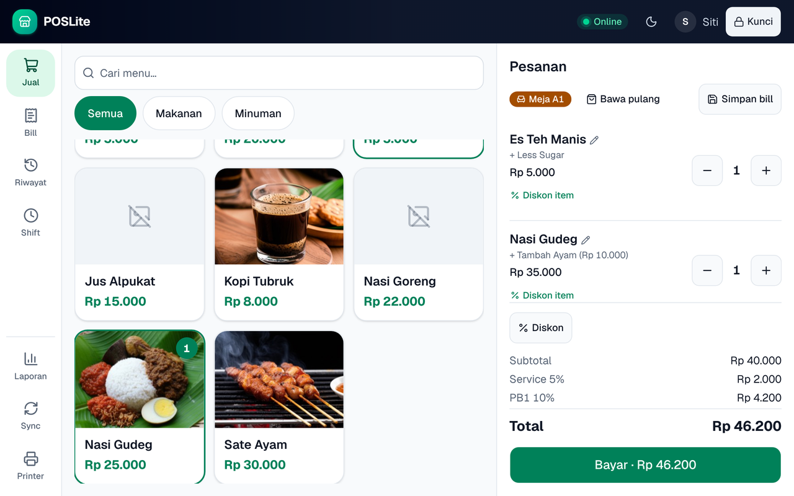

**Usulan**

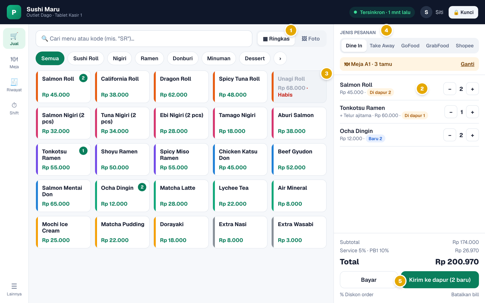

**Penanda**

1. Pilihan tampilan **Ringkas / Foto**, disimpan per device. Mode ringkas memakai 5 kolom, tile teks dengan strip warna kategori, dan ±25 menu per layar. Mode foto tetap untuk outlet yang menginginkannya.
2. **Status baris**: tag "Di dapur n" (kuning) dan "Baru n" (biru). Mengurangi qty di bawah jumlah yang sudah di dapur membuka dialog UX-05.
3. **Menu habis**: tile abu-abu dengan label "Habis". Tekan lama tile untuk menandai habis atau tersedia (14 · P1-2, sudah selesai).
4. **Jenis pesanan di atas keranjang** dalam bentuk segmented control yang jelas: Dine In / Take Away / GoFood / GrabFood / ShopeeFood (dari master channel, 14 · P0-2). Harga di grid mengikuti channel aktif.
5. Untuk dine-in, **aksi utama adalah "Kirim ke dapur (n baru)"**, sedangkan Bayar menjadi sekunder. Diskon order dan Batalkan bill menjadi tautan teks kecil di bawah. Diskon per item pindah ke dialog edit baris (ikon pensil).

**Spesifikasi**

- Pencarian juga menerima **kode menu** (field `sku` produk yang sudah ada) untuk kasir yang hafal kode.
- Placeholder menu tanpa foto (mode foto): blok warna kategori + inisial nama menu, bukan ikon gambar rusak.
- Untuk take away: field **nama pelanggan / nomor antrian** di atas keranjang (14 · P1-1, sudah selesai).
- Mode ringkas menjadi **default untuk device baru**. Manajer bisa mengganti.
- **Segmented control di layar sempit**: tampilkan maksimal 3 channel (urut `sortOrder`) ditambah tombol "Lainnya ▸" berisi sisanya. Di tablet landscape semua channel tampil bila muat. Channel aktif selalu terlihat, walaupun berasal dari "Lainnya".

**Backend**: tidak ada. Channel, harga per channel, `sku`, nomor antrian, dan menu habis sudah tersedia di delta pull.

**File terdampak**: `features/catalog/components/ProductGrid.tsx`, `features/cart/components/CartLines.tsx`, `LineDiscountDialog.tsx`, `features/catalog/components/LineEditorDialog.tsx`, `features/bills/components/DineInBar.tsx`, `app/(pos)/sell/*`.

**DoD**: e2e `sell-offline.spec.ts` dan `dine-in-offline.spec.ts` lulus di kedua mode tampilan; test komponen untuk tag status baris, tile habis, dan channel aktif dari "Lainnya" tetap terlihat.

---

### UX-07 — Toast

**Status: selesai** (branch `feat/ux-07-toast`). Catatan implementasi:

- Semua toast lewat `shared/ui/toast.ts` (sukses 2 detik, error sampai ditutup dengan tombol tutup); ESLint menolak `toast` langsung dari `sonner`.
- Posisi diatur di `shared/ui/sonner.tsx`: lebar ≥ 768 px di bawah tengah dengan offset 120 px, HP di atas dengan offset 72 px.
- Toast "Shift dibuka" dihapus. Penyembunyian toast sukses saat dialog terbuka tidak dibuat sebagai aturan umum; yang dibuang hanya toast yang memang menutupi dialog pertama.
- e2e `dine-in-offline.spec.ts` memeriksa posisi toast di keempat layout (`expectToastClear` di `tests/e2e/layout.ts`).

**Masalah**: `<Toaster position="top-center" offset={72} duration={2500} />` di `app/layout.tsx` menutupi judul dan harga di dialog modifier, teks penjelasan di layar Bill, dan header layar Bayar. Toast "Shift dibuka" bahkan masih tampil saat kasir sudah membuka dialog menu pertama.

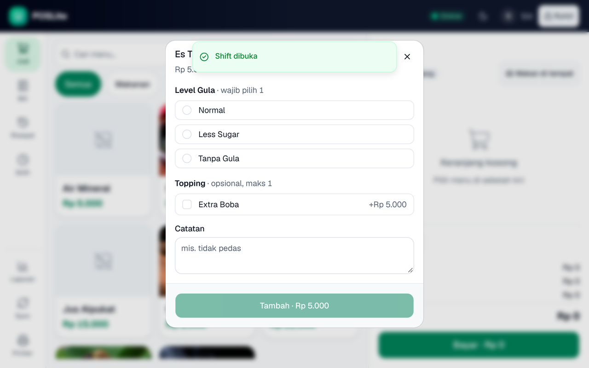

**Spesifikasi**

- Tablet: `position="bottom-center"` dengan offset **120 px** dari bawah (ringkasan bawah layar Bayar ≤ 96 px + jarak 24 px), supaya toast tidak menutupi tombol "Selesaikan" atau "Kirim ke dapur".
- HP: tetap atas, karena bawah sudah dipakai bottom nav dan bar "Lihat pesanan".
- Durasi 2 detik untuk sukses. Error tetap tampil sampai ditutup.
- Saat dialog terbuka, toast sukses yang tidak penting tidak perlu ditampilkan (misalnya "Shift dibuka" cukup tercermin dari perubahan layar).
- Jangan tampilkan angka sensitif di toast (lihat UX-02).

**Backend**: tidak ada.

**DoD**: Playwright project `tablet` memeriksa toast tidak bertumpuk dengan tombol "Selesaikan" (bounding box tidak beririsan).

---

### UX-08 — Pengaturan Printer

**Masalah**

- Layar Printer bisa dibuka kasir dan penuh istilah teknis: "Dialog cetak sistem", "USB (WebUSB)", "Bluetooth / USB (Web Serial)", "Printer LAN lewat Print Bridge", "Printer LAN Epson (ePOS)".
- Tiga kartu (Struk, Dapur, Bar) masing-masing berisi 6–7 radio, tanpa status apakah printer siap.

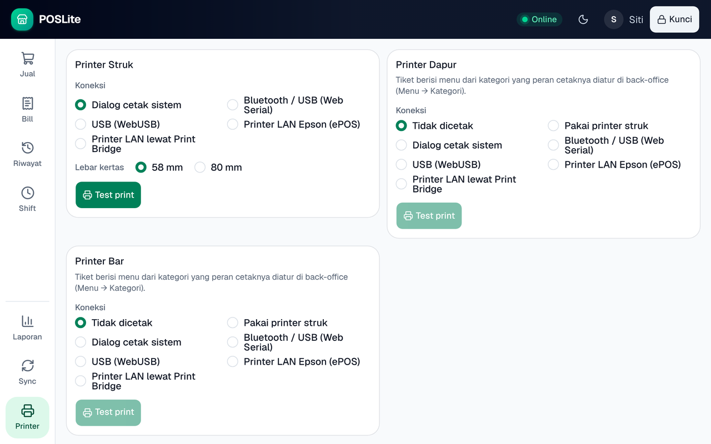

**Usulan**

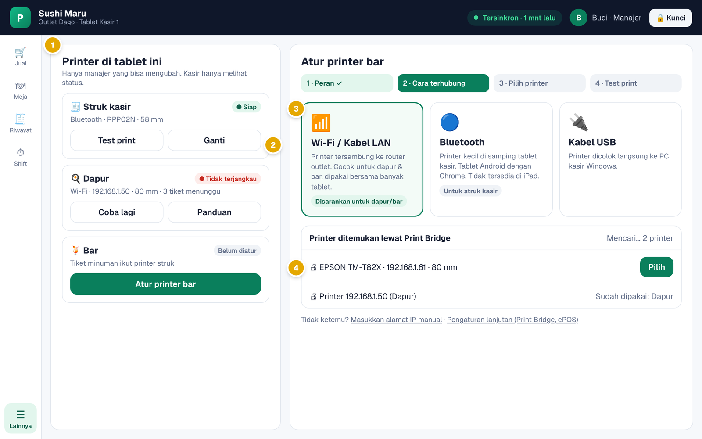

**Penanda**

1. Daftar printer per peran (Struk kasir, Dapur, Bar) dengan **status**: Siap, Tidak terjangkau (beserta jumlah tiket menunggu), atau Belum diatur. **Hanya manajer** yang bisa mengubah; kasir hanya melihat status dan bisa Test print.
2. Aksi langsung per printer: Test print, Ganti, Coba lagi, atau Panduan (panduan bergambar untuk masalah umum).
3. **Wizard 4 langkah** (Peran → Cara terhubung → Pilih printer → Test print) dengan bahasa operasional: **Wi-Fi / Kabel LAN**, **Bluetooth**, dan **Kabel USB**, masing-masing dengan keterangan kapan dipakai. Bluetooth memberi tahu bahwa fitur ini tidak tersedia di iPad.
4. **Penemuan printer di jaringan dilakukan oleh Print Bridge**, karena browser tidak bisa memindai jaringan. Pilihan teknis (ePOS, alamat bridge manual) dipindah ke "Pengaturan lanjutan".

**Spesifikasi**

- Status printer diambil dari antrian cetak (`printJobs`) dan hasil test print terakhir.
- Saat printer dapur gagal di tengah layanan, tampilkan banner kecil di layar Jual ("Printer dapur tidak terjangkau · 3 tiket menunggu · Coba lagi"). Kasir harus tahu, karena dapur tidak menerima pesanan.
- Pemetaan internal tetap memakai driver yang ada (ADR-007). Yang berubah hanya cara pemilihan dan bahasanya.
- Bila bridge tidak punya `/discover` (versi lama), langkah "Pilih printer" menampilkan input alamat IP manual.

**Backend**

- `poslite-api`: tidak ada. Pengaturan printer tetap per device.
- `poslite-print-bridge`: endpoint baru `GET /discover`, bagian dari 14 · P1-5. Memindai port 9100 di subnet lokal, mengembalikan daftar `{ host, port }`, dan wajib memakai token pairing yang sama dengan `/print`. Batasi waktu pindai (mis. ≤ 5 detik) dan jangan memindai di luar subnet antarmuka bridge.

**File terdampak**: `features/printing/components/PrinterSettings.tsx`, `PrinterAddressForm.tsx`, `app/(pos)/printer/*`, `poslite-print-bridge/src/server.ts` (discover).

**DoD**: test bridge untuk `/discover` dengan socket palsu (tanpa jaringan asli) dan penolakan tanpa token; test komponen wizard untuk kasir (hanya lihat status + Test print) dan manajer.

---

### UX-09 — Mode Daftar untuk HP Pelayan

**Masalah**: di HP, grid 2 kolom dengan foto besar hanya memuat ±4 menu per layar. Pelayan yang mencatat pesanan di meja butuh daftar yang padat dan bisa dipakai dengan satu tangan.

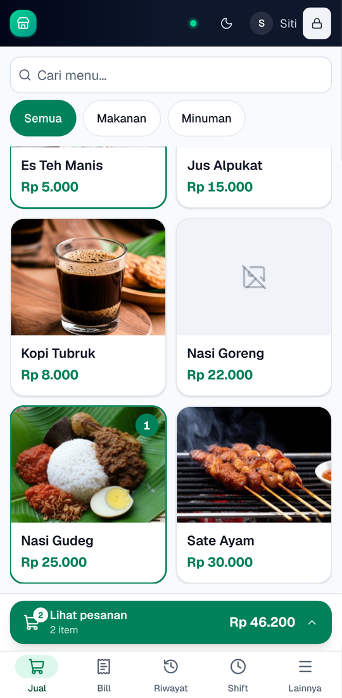

**Usulan**

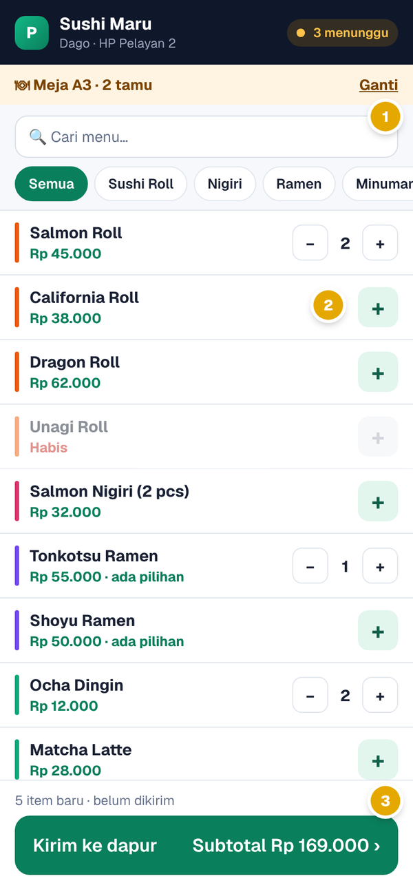

**Penanda**

1. Meja aktif menempel di atas (bisa diganti). Badge sync ringkas di header.
2. **Mode daftar**: satu baris per menu dengan strip warna kategori dan tombol **+** besar di kanan, yang berubah menjadi stepper setelah ditambah. Menu dengan modifier ditandai "ada pilihan".
3. Tombol bawah **"Kirim ke dapur"** beserta jumlah item baru dan subtotal.

**Catatan**: shared open bill (14 · P0-4) dan peran `waiter` sudah selesai, jadi backend siap untuk alur pelayan. Bila outlet pilot memakai mode `table_service`, naikkan UX-09 ke prioritas Tinggi dan kerjakan sebelum dry run.

**Backend**: tidak ada.

---

### UX-10 — Label Laporan & Ringkasan Kas Shift

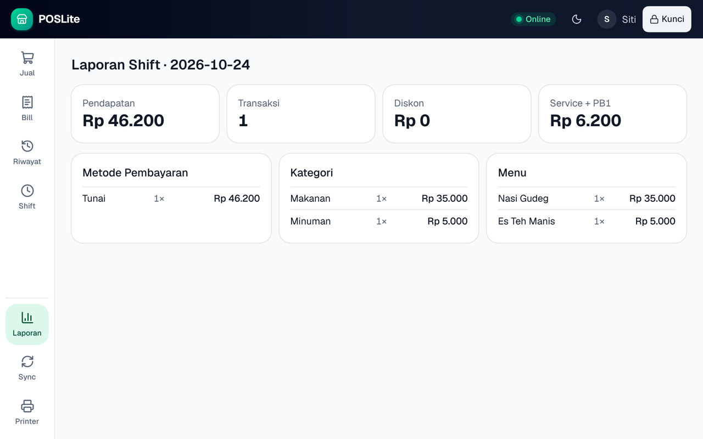

| Sekarang | Usulan | Alasan |
|---|---|---|
| Pendapatan Rp 46.200 | **Total diterima** Rp 46.200 · **Penjualan bersih** Rp 40.000 | "Pendapatan" yang sudah termasuk pajak dan service menyesatkan owner dan akuntan |
| Service + PB1 Rp 6.200 | Service Rp 2.000 · PB1 Rp 4.200 | PB1 disetor ke pemda dan dilaporkan terpisah |
| Penjualan tunai Rp 50.000 / Kembalian −Rp 3.800 | **Penjualan tunai (bersih)** Rp 46.200 | Kasir berpikir dalam uang bersih yang masuk laci |
| — | Void / batal sebelum bayar: n · Rp x (manajer saja) | Data dari 14 · P0-1 |
| — | Per channel (Dine In, Take Away, GoFood, …) | Data dari 14 · P0-2 |

**Backend**: tidak ada. `rpt_daily_sales` sudah memisahkan `service` dan `tax`, dan sudah punya `pre_payment_void_count` / `pre_payment_void_amount`; laporan per channel ada di `rpt_daily_channel_sales`. Bila back-office juga memakai label "Pendapatan", samakan labelnya di `poslite-admin`.

**File terdampak**: `features/reports/components/ReportsScreen.tsx`, `features/shift/components/ShiftOverview.tsx`, copy di `features/*/copy.ts`.

---

### UX-11 — Identitas Visual & Layar Kunci

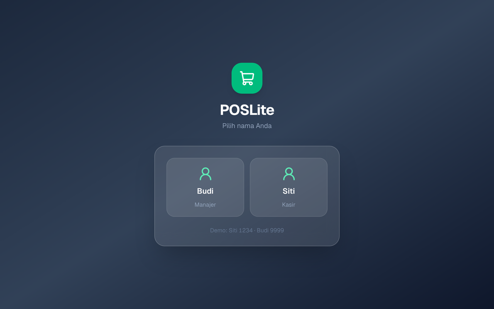

- **Satu logo.** Layar aktivasi dan layar kunci memakai ikon troli belanja, sedangkan header memakai ikon toko. Troli juga lebih terasa retail daripada restoran. Pilih satu logo POSLite dan pakai di semua layar, termasuk ikon PWA di `manifest.ts`.
- **Layar kunci dan PIN** menampilkan **logo dan nama brand + outlet**. Kasir di grup multi-brand harus tahu sedang berada di outlet mana sebelum login.
- **Petunjuk demo** ("Demo: Siti 1234 · Budi 9999") hanya muncul di mode demo, dan bersama banner UX-01.
- **Kontras**: teks petunjuk abu-abu di atas latar gelap terlalu lemah. Naikkan ke minimal rasio 4.5:1 (WCAG AA).
- Periksa **dark mode** untuk semua usulan di dokumen ini. Warna status (kuning/merah/biru) harus tetap terbaca di tema gelap.

**Backend**: tidak ada. Logo brand sudah sampai di device (`logoKey`, URL = `mediaBaseUrl` + key, ADR-021).

---

## 4. Token & Komponen Baru

Tambahkan di `globals.css` dan `shared/ui` supaya warna status konsisten di semua layar:

| Token / komponen | Pemakaian | Catatan |
|---|---|---|
| `--status-kitchen` (warning) | Tag "Di dapur", meja terisi | Pakai `--warning` yang sudah ada sebagai teks, `/10` sebagai latar |
| `--status-new` (info) | Tag "Baru", meja tagihan dicetak | Token baru: biru, AA di atas putih |
| `--status-late` (destructive) | Meja > 90 menit, sync gagal | Pakai `--destructive` |
| `StatusPill` | Badge sync, status printer, status meja | Satu komponen dengan varian `ok / wait / error / neutral` |
| `ManagerApproval` | Batal bill, void, refund, diskon di atas batas, rincian tutup shift | Sudah ada di `features/auth` (UX-05) |
| `DenominationCounter` | Tutup shift (opsional juga buka shift) | Daftar pecahan dari pengaturan (default Rupiah) |
| `SegmentedControl` | Jenis pesanan, mode tampilan, area meja | Satu komponen yang jelas status aktifnya, dengan overflow "Lainnya ▸" |

## 5. Urutan Pengerjaan

Item P0 dan sebagian besar P1 di dokumen 14 sudah selesai, sehingga sebagian besar pekerjaan UX tinggal di sisi web. Urutan di bawah mempertimbangkan tiga hal:

1. **Dampak ke kepercayaan dan anti-fraud** lebih dulu.
2. **Ketergantungan komponen**: `ManagerApproval` (UX-05) dipakai UX-02.
3. **Urutan deploy**: perubahan API untuk UX-02 dan UX-04 harus sudah di staging sebelum perubahan web-nya digabung.

| # | Pekerjaan | Repo | Tahap di 14 | Catatan |
|---|---|---|---|---|
| 1 | UX-01 Status sync + banner demo | web, deploy | Paralel Tahap C/D | Tidak bergantung pada apa pun |
| 2 | UX-05 Dialog batal bill + ekstrak `ManagerApproval` | web | Paralel Tahap C/D | Backend sudah ada |
| 3 | UX-07 Toast | web | Paralel Tahap C/D | 0,5 hari; bisa diselipkan kapan saja |
| 4 | UX-02 bagian API: migrasi `0032`, payload, `blind_close`, admin ✅ | api, admin | Tahap D | Deploy ke staging sebelum langkah 5 |
| 5 | UX-02 bagian web: hitung buta per pecahan ✅ | web | Tahap D | Memakai `ManagerApproval` dari langkah 2 |
| 6 | UX-03 Layar Bayar ✅ | web | Tahap D | |
| 7 | UX-04 bagian API: migrasi `0033`, field open bill | api | Tahap D | Deploy ke staging sebelum langkah 8 |
| 8 | UX-04 bagian web: layar Meja | web | Tahap D | |
| 9 | UX-06 Layar Jual | web | Tahap D | |
| 10 | UX-10 Label laporan | web (+ admin bila perlu) | Tahap D | |
| 11 | UX-08 Printer + `GET /discover` | web, bridge | Tahap D, bersama P1-5/P1-6 | Diuji dengan printer asli di P1-6 |
| 12 | UX-11 Identitas visual | web | Tahap E, sebelum dry run | |
| 13 | UX-09 HP pelayan | web | Tahap E, atau setelah pilot | Naik ke langkah 9 bila outlet pilot memakai `table_service` |

**Gerbang**: semua item prioritas Tinggi (UX-01 sampai UX-05) harus selesai sebelum dry run (14 §7.3), supaya kasir pilot mencoba layar yang akan dipakai saat pilot.

Semua perubahan mengikuti alur TDD di `poslite-web/AGENTS.md` dan `poslite-api/AGENTS.md`: test dulu, lalu implementasi. Di web, test komponen memakai query berdasarkan role/label, lalu spec Playwright yang terdampak diperbarui di keempat project (`chromium`, `tablet`, `tablet-portrait`, `phone`). Di API, `make api-check` harus lulus dan `openapi.json` diperbarui bila kontrak berubah.

## 6. Checklist

- [x] UX-01 Badge status sync selalu tampil (dengan urutan kondisi) + banner mode demo + demo dimatikan di produksi
- [x] UX-05 Dialog batal bill dengan alasan + PIN; `ManagerApproval` diekstrak
- [x] UX-07 Toast tidak menutupi konten
- [x] UX-02 API: migrasi `0032`, `denominations` di payload dan detail shift, `blind_close`, toggle dan rincian di admin
- [x] UX-02 Web: hitung buta per pecahan; kasir tidak pernah melihat expected/selisih
- [x] UX-03 Keypad terlihat tanpa scroll di tablet; metode bayar dikelompokkan; cetak otomatis
- [ ] UX-04 API: migrasi `0033`, `guest_count` dan `printed_at` di open bill
- [ ] UX-04 Web: layar Meja dengan status dan urutan status; Batalkan dipisah dan berwarna merah
- [ ] UX-06 Mode ringkas, jenis pesanan di awal (dengan overflow), status baris dapur, aksi utama "Kirim ke dapur"
- [ ] UX-10 Label laporan & ringkasan kas
- [ ] UX-08 Printer: khusus manajer, wizard, status per printer, bahasa operasional; bridge `GET /discover`
- [ ] UX-11 Satu logo, brand + outlet di layar kunci, kontras AA, cek dark mode
- [ ] UX-09 Mode daftar HP pelayan
- [ ] Nomor migrasi `0032` dan `0033` dicatat di 14 §3.1
- [ ] Semua e2e hijau di `chromium`, `tablet`, `tablet-portrait`, `phone`; `make api-check` hijau
- [ ] Uji langsung dengan 2 kasir restoran pilot (lihat 14 §7.3) sebelum Go/No-Go

## Lampiran — Daftar Gambar

| File | Isi |
|---|---|
| `before-demo-header.png` | Mode demo dengan badge "Online" |
| `before-orders-pending.png` | Order "Pending" sementara header "Online" |
| `before-shift-overview.png` | Shift berjalan menampilkan expected cash ke kasir |
| `before-checkout.png` | Layar bayar dengan keypad terpotong (tablet landscape) |
| `before-table-picker.png` | Pemilih meja tanpa status |
| `before-bills.png` | Daftar bill terbuka |
| `before-sell-dinein.png` | Layar jual dine-in |
| `before-toast-overlap.png` | Toast menutupi dialog modifier |
| `before-printer.png` | Layar printer dengan istilah teknis |
| `before-phone-sell.png` | Layar jual di HP |
| `before-shift-report.png` | Laporan shift |
| `before-lock.png` | Layar pilih kasir |
| `mockup-01-header-sync-status.png` | UX-01: empat status header |
| `mockup-02-sell-compact.png` | UX-06: layar jual mode ringkas |
| `mockup-03-checkout.png` | UX-03: layar bayar |
| `mockup-04-tables.png` | UX-04: layar meja |
| `mockup-05-cancel-bill-dialog.png` | UX-05: dialog batal bill |
| `mockup-06-close-shift-blind.png` | UX-02: tutup shift hitung buta |
| `mockup-07-printer-setup.png` | UX-08: pengaturan printer |
| `mockup-08-phone-waiter.png` | UX-09: HP pelayan mode daftar |
| `src/*.html`, `src/base.css` | Sumber mockup (HTML/CSS) |
